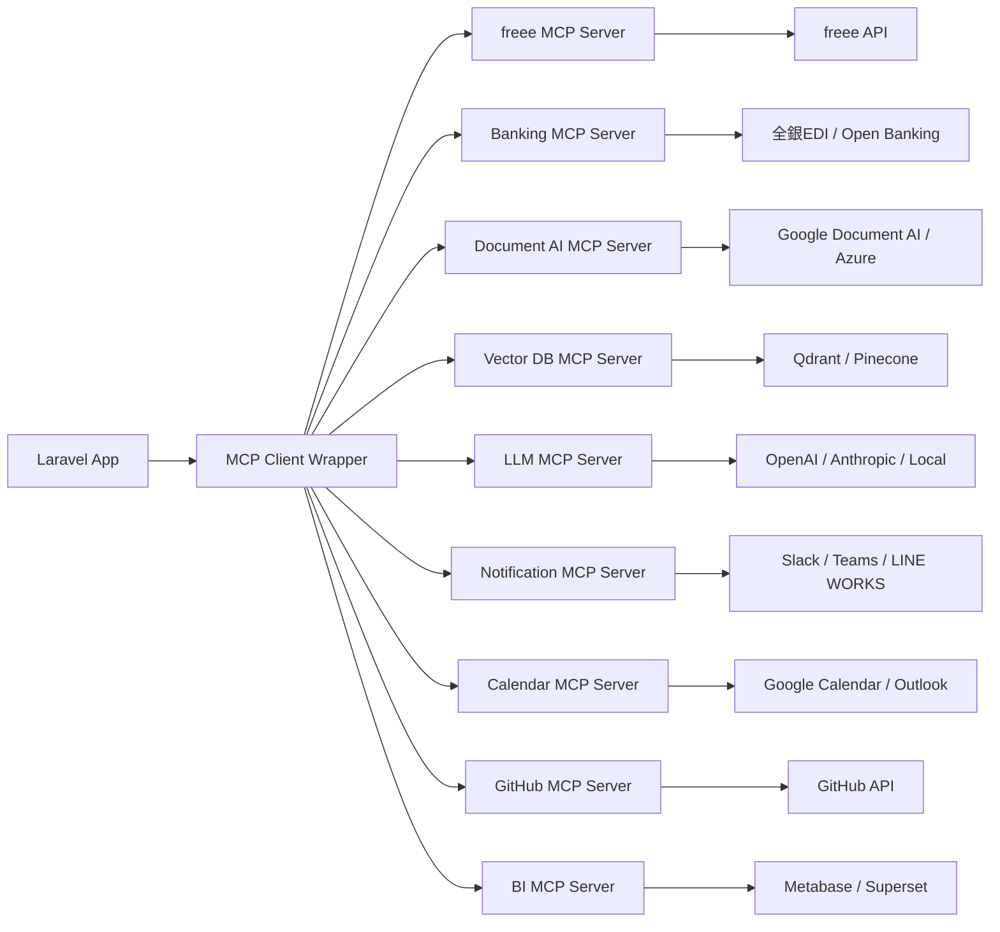

# MCPサーバー活用改善提案書（9案）

**作成日**: 2026-10-13  
**対象**: 介護施設向け請求管理システム（Laravel + Filament）

---

## 1. 【会計連携】freee / MFクラウド会計 MCPサーバー連携

### 概要
請求確定データをワンクリックで会計ソフト（freee、MFクラウド会計）へ自動仕訳登録。

### MCP活用
- **freee API MCP Server** / **MF Cloud Accounting MCP Server**
- 仕訳データの生成・送信・エラー処理をMCPツールとして抽象化

### 実装メリット
- `AccountingExportProfile` と `ChartOfAccount` の設定をそのまま活用
- 手作業のCSVエクスポート・インポート作業を完全自動化
- 仕訳ルール変更時もMCP側で吸収、アプリ改修不要

### 対象ファイル
- `app/Services/InvoiceCsvExportService.php`
- `app/Filament/Resources/AccountingExportProfileResource.php`
- `database/migrations/*_create_accounting_export_profiles_table.php`

---

## 2. 【帳票OCR】請求書・領収書PDFの自動読み取り・検証

### 概要
生成済みPDFや外部から受領した請求書PDFをOCR解析し、DBデータと突合検証。

### MCP活用
- **Document AI MCP Server** (Google Document AI / Azure Form Recognizer / AWS Textract)
- PDF → 構造化データ変換をMCPツール化

### 実装メリット
- 入金確認時の領収書OCR自動照合
- 過去PDFの一括データ化・検索インデックス化
- `InvoicePdfService::generateMonthlyZip()` 連携で生成直後自動検証可能

### 対象ファイル
- `app/Services/InvoicePdfService.php`
- `app/Models/MonthlyInvoice.php` (税区分・金額突合)
- `app/Console/Commands/CleanupOldInvoicePdfs.php`

---

## 3. 【銀行API】入金照合の完全自動化（全銀EDI / オープンバンキング）

### 概要
銀行口座の入金明細を自動取得し、請求書と突合して `markAsPaid()` を自動実行。

### MCP活用
- **Banking API MCP Server** (全銀EDI / 各行オープンバンキングAPI統一インターフェース)
- 入金明細取得・照合ロジックをMCP側で実行、結果のみ受信

### 実装メリット
- 手動入金消込作業の撲滅
- `MonthlyInvoice::markAsPaid()` への自動連携
- 入金遅延アラートの自動通知

### 対象ファイル
- `app/Models/MonthlyInvoice.php` (markAsPaid)
- `app/Enums/PaymentMethod.php`
- `app/Filament/Resources/MonthlyInvoiceResource.php`

---

## 4. 【AIチャットボット強化】RAG + Function Calling による高度化

### 概要
現行のルールベースチャットボットを、ベクトル検索（RAG）とFunction Calling対応LLMに置換。

### MCP活用
- **Vector DB MCP Server** (Qdrant / Pinecone / Weaviate) - FAQ・マニュアル・過去ログのベクトル化・検索
- **LLM MCP Server** (OpenAI / Anthropic / ローカルLLM) - Function Calling で `resident_lookup`, `invoice_amount` 等のツール呼び出し

### 実装メリット
- 自然言語での複雑な質問対応（「先月の未払い入居者を全部教えて」「A施設とB施設の売上比較」）
- 既存 `ChatbotService` の `IntentRecognizer` / `FaqResponder` を段階的に置換可能
- `CHATBOT_9_IMPROVEMENT_PLAN.md` の Phase 8-9 をMCPで一括解決

### 対象ファイル
- `app/Services/Chatbot/ChatbotService.php`
- `app/Services/Chatbot/IntentRecognizer.php`
- `app/Services/Chatbot/FaqResponder.php`
- `config/chatbot.php`

---

## 5. 【通知ハブ】Slack / Teams / LINE WORKS 統合通知MCP

### 概要
請求確定・未入金・エスカレーション等のイベントを複数チャネルに最適な形式で配信。

### MCP活用
- **Notification MCP Server** - 各種メッセージングAPIを統一インターフェースでラップ
- テンプレート管理・リトライ・レート制御をMCP側で集中管理

### 実装メリット
- `spatie/laravel-activitylog` のイベントフックで自動通知
- `ChatEscalation` 発生時の即時Slack/Teamsメンション
- 月次締め処理完了・エラー時の運用チーム自動通知

### 対象ファイル
- `app/Models/ChatEscalation.php`
- `app/Jobs/GenerateMonthlyZipJob.php`
- `app/Console/Commands/GenerateMonthlyInvoices.php`

---

## 6. 【ブラウザ自動化】E2Eテスト・スクレイピング・帳票ダウンロード

### 概要
Playwrightベースのブラウザ自動化で、外部サイトからのデータ取得やE2Eテストを実行。

### MCP活用
- **Playwright MCP Server** - ヘッドレスブラウザ操作をMCPツールとして提供
- 認証付きサイトへのログイン・帳票ダウンロード・スクレイピングを自動化

### 実装メリット
- 介護保険請求ソフト（レセプトソフト）からのCSV自動取得・取込
- `tests/Feature/InvoicePdfServiceZipTest.php` 等のブラウザテスト実行
- 公開サイトのフォーム送信テスト自動化

### 対象ファイル
- `.github/workflows/ci.yml` (website-checks)
- `tests/Feature/InvoicePdfServiceZipTest.php`
- `app/Http/Controllers/FormController.php`

---

## 7. 【カレンダー連携】請求締め・入金期日・面談スケジュール自動登録

### 概要
請求業務の重要日付をGoogle Calendar / Outlook に自動同期。

### MCP活用
- **Calendar MCP Server** (Google Calendar API / Microsoft Graph API)
- 繰り返しイベント・リマインダー・出席者設定をMCPで管理

### 実装メリット
- 月次請求締め日・入金期限の自動カレンダー登録
- 入居者面談・契約更新日のリマインダー設定
- `Facility` ごとの業務カレンダー共有

### 対象ファイル
- `app/Models/Facility.php`
- `app/Console/Commands/GenerateMonthlyInvoices.php`
- `app/Filament/Resources/FacilityResource.php`

---

## 8. 【GitHub連携】デプロイ・リリース・Issue自動連携

### 概要
本番デプロイ時のタグ付け・リリースノート生成・Issueクローズを自動化。

### MCP活用
- **GitHub MCP Server** - PR作成・リリース作成・Issue操作・ワークフロー派遣をMCPツール化

### 実装メリット
- `CHANGELOG.md` 自動生成・GitHub Releases 連携
- バグ報告Issueから修正PR自動リンク
- `railway.json` デプロイ完了後の自動タグ付け

### 対象ファイル
- `.github/workflows/ci.yml`
- `railway.json`
- `CHANGELOG.md`

---

## 9. 【データ分析】BIツール連携（Metabase / Apache Superset）MCP

### 概要
請求・入金・入居率等のKPIをBIツールで可視化、自然言語クエリ対応。

### MCP活用
- **BI MCP Server** - Metabase / Superset API ラッパー
- ダッシュボード自動生成・クエリ実行・埋め込みURL発行をMCPで実行

### 実装メリット
- 施設別・月次売上・未収金・入居率のリアルタイムダッシュボード
- 経営層向け「今月の未入金額は？」等の自然言語クエリ対応
- `InvoiceCalculationService` の統計データを直接可視化

### 対象ファイル
- `app/Services/InvoiceCalculationService.php`
- `app/Models/MonthlyInvoice.php`
- `app/Models/Resident.php`
- `app/Filament/Widgets/*.php`

---

## 実装優先度マトリクス

| 優先度 | 提案 | 期待効果 | 技術的難易度 | 着手目安 |
|:---:|:---|:---|:---:|:---:|
| **高** | 1. 会計連携 | 経理工数 80%削減 | ★★☆☆☆ | 即時 |
| **高** | 3. 銀行API連携 | 入金消込工数 90%削減 | ★★★☆☆ | 1ヶ月以内 |
| **中** | 5. 通知ハブ | 見落としゼロ・対応速度向上 | ★★☆☆☆ | 2週間以内 |
| **中** | 4. AIチャットボット | 問い合わせ解決率向上 | ★★★★☆ | 2-3ヶ月 |
| **中** | 2. 帳票OCR | 監査対応・検索性向上 | ★★★☆☆ | 1-2ヶ月 |
| **低** | 7. カレンダー連携 | スケジュール管理効率化 | ★★☆☆☆ | 1ヶ月以内 |
| **低** | 8. GitHub連携 | リリース作業自動化 | ★★☆☆☆ | 1ヶ月以内 |
| **低** | 6. ブラウザ自動化 | 外部連携・テスト自動化 | ★★★★☆ | 3ヶ月〜 |
| **低** | 9. BI連携 | 経営可視化・データドリブン | ★★★☆☆ | 2-3ヶ月 |

---

## MCPサーバー導入アーキテクチャ案



---

## 共通MCPクライアント実装方針

```php
// app/Services/Mcp/McpClient.php (新規作成)
class McpClient
{
    public function __construct(
        private HttpClient $http,
        private string $baseUrl,
        private string $apiKey,
    ) {}

    public function callTool(string $server, string $tool, array $params): McpResponse
    {
        // 統一インターフェースでMCPツール呼び出し
        // リトライ・タイムアウト・エラーハンドリング・ログを集中管理
    }
}

// 使用例: 会計連携
$mcp = app(McpClient::class);
$result = $mcp->callTool('freee', 'create_journal_entry', [
    'company_id' => $facility->freee_company_id,
    'journal' => $this->buildJournalEntry($invoice),
]);
```

---

## 次のアクション

1. **PoC実施**: 優先度高の「1. 会計連携」でMCPクライアント基盤 + freee MCPサーバーを検証
2. **インフラ整備**: MCPサーバー群のコンテナ化・デプロイ（Docker Compose / Kubernetes）
3. **段階的導入**: 既存機能を壊さず、サービスクラス単位でMCP呼び出しに置換
4. **監視・ログ**: MCP呼び出しの成功率・レイテンシ・エラー率をDatadog/Prometheusで可視化