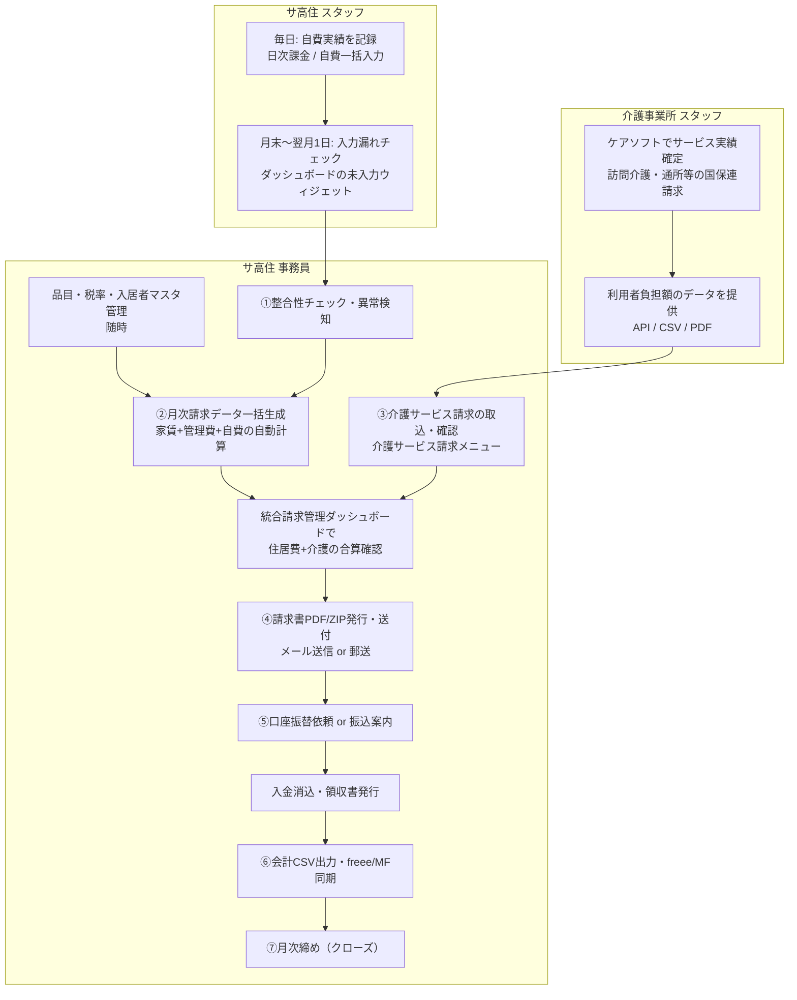

# 三者分業ワークフロー（サ高住 事務員 × サ高住 スタッフ × 介護事業所 スタッフ）

> **バージョン**: v1.7.2 時点の実装に準拠（2026-10-14）
> **対象読者**: サ高住（サービス付き高齢者向け住宅）の事務員・現場スタッフ、および提携・関連する介護事業所（訪問介護・居宅介護支援等）のスタッフ
> **このドキュメントの位置づけ**: 月次請求業務を「3者が分業」して回すための総覧。各工程の細かい操作手順は 01〜05 の業務フロー書を参照。

---

## 1. 三者の役割とシステム権限の対応

| 役割 | 主な仕事 | システム上のアカウント種別 | 利用する主な画面 |
|------|----------|---------------------------|------------------|
| **サ高住 スタッフ**（現場介護職） | 入居者の日々の自費利用実績を毎日記録 | `care_staff`（現場スタッフ） | 日次課金、自費一括入力 |
| **サ高住 事務員** | 請求書の作成・発行・送付、入金消込、領収書、会計連携、マスタ管理 | `facility_admin`（施設管理者）または `accountant`（経理担当者） | 月次請求書、介護サービス請求、統合請求管理ダッシュボード、月次締めウィザード |
| **介護事業所 スタッフ** | 介護サービス実績の管理、ケアソフトでの請求、サ高住への自己負担額のデータ提供 | アカウントなし（外部連携者）※またはサ高住事務員が代行入力 | ケアソフト（外部）＋ API / CSV / PDF で連携 |

> **補足**: 介護事業所がサ高住と同一法人内にある場合でも、システムの操作（介護サービス請求の登録・確定）は基本「サ高住事務員」が行います。介護事業所スタッフは**データの提供元**です。

### 権限の考え方（重要）

- サ高住スタッフ（`care_staff`）は**自費実績の入力のみ**可能です。請求の確定・入金消込・全銀出力はできません（`MonthlyInvoicePolicy` で拒否）。
- 請求確定・入金消込・会計CSV出力は `facility_admin` / `accountant` / `corporate_admin`（法人統括管理者）のみ。
- 自費実績の**記録の締め**はシステムが自動で守ります。請求確定（Billed）以降の日次データは原則編集不可です。

---

## 2. 全体フロー（スイムレーン図）



---

## 3. 月間スケジュール（担当者別・いつ何をするか）

| 時期 | サ高住 スタッフ | 介護事業所 スタッフ | サ高住 事務員 |
|------|----------------|---------------------|---------------|
| **毎日** | 自費実績を記録（日次課金 / 自費一括入力） | （訪問記録・実績管理は介護事業所側のシステム） | ― |
| **月末** | 入力漏れチェック（未入力ウィジェット） | ケアソフトで当月実績を確定 | 品目マスタ・税率の見直し（必要時） |
| **翌月1日** | ― | ― | 自動生成：請求データが毎月1日 02:00 に自動生成（手動再実行も可） |
| **翌月2〜5日** | ― | **ケアソフトで国保連請求提出 → 利用者負担額をサ高住へ提供**（API / CSV / PDF） | ①整合性チェック（月次締めウィザード）→ ②請求データ生成・金額確認 |
| **翌月5〜10日** | ― | データ提供の残・差分対応 | ③介護サービス請求の取込・確定（Confirmed） |
| **翌月10〜15日** | ― | 修正依頼があれば対応 | 統合請求管理ダッシュボードで合算確認 → ④請求書PDF発行・送付 |
| **翌月15〜20日** | ― | ― | ⑤口座振替依頼出力（全銀）or 振込確認 |
| **翌月20〜25日** | ― | ― | 入金消込・領収書発行 |
| **翌月25日〜月末** | ― | ― | ⑥会計CSV出力 / freee・MF同期 → ⑦月次締め（クローズ） |

> 日付は目安です。 facility ごとの締めスケジュールに合わせて調整してください。

---

## 4. 日次業務の分業（サ高住スタッフ → 事務員）

### サ高住スタッフの作業（毎日 5〜10分）

| Step | 作業 | 画面 |
|------|------|------|
| 1 | その日自費を利用した入居者を確認（おむつ・日用品・理美容・立替金など） | ―（帳票・申し送り） |
| 2 | 利用実績を入力 | **日次課金**（1件ずつ）or **自費一括入力**（複数入居者をまとめて） |
| 3 | 品目を選ぶと単価が自動反映（品目マスタに登録済み）→ 数量だけ入れる | 自費一括入力 |
| 4 | 定番パターン（例: 毎日おむつ2枚）は**プリセット**で一括展開 | 自費一括入力 → プリセット一括モード |
| 5 | スマホ・タブレットからは API でも記録可能 | モバイルAPI（`/api/mobile/daily-charges`） |

**注意点:**
- 単価・税区分は品目マスタ（`ItemMaster`）の設定から自動反映。変わっている場合は**事務員に連絡**（スタッフは勝手にマスタを直さない）。
- 利用日が入居者の在籍期間（入居日〜退去日）外だと保存できません。退去日が決まったら事務員へ連絡。
- **請求が確定済み（Billed/Paid）の月の入力はできません**（確定月ガード）。請求確定後に漏れが見つかったら事務員へ。

### 事務員がスタッフから受けるもの

- 何も「受取」作業は不要。スタッフの入力は即座にシステムに反映され、月次請求生成時に自動集計されます。
- 事務員は**月末〜翌月初にダッシュボードの「未入力チェック」ウィジェット**で漏れを最終確認するだけ。

---

## 5. 介護サービスデータの引き渡し（介護事業所 → 事務員）

介護事業所スタッフが管理するのは、**介護保険サービス（訪問介護・通所介護・居宅介護支援等）の利用者負担額（1割負担分など）**です。国保連への請求はケアソフトで行い、その**自己負担額**をサ高住の請求書に載せるために以下のいずれかの方法で引き渡します。

> **運用導入の目安（スモールスタート推奨）:**
> - **初期フェーズ（まずは始める場合）**: **方法③（PDF持参 / 手入力）** で運用を開始。
> - **拡大フェーズ（件数・事業所が増加した場合）**: **方法②（CSV取込）** や **方法①（API連携）** を順次導入し、自動化を進めます。

### 方法①: API連携（推奨・自動化）

| 項目 | 内容 |
|------|------|
| **前提** | サ高住事務員が管理画面「APIトークン」で介護事業所用トークンを発行（スコープ `invoices.write`、施設固定） |
| **送信** | `POST /api/external-invoices`（一括）または `/api/external-invoices/single`（1件） |
| **内容** | 入居者ID・サービス種別・請求年月・金額・税額・税率（PDFのbase64も添付可） |
| **制約** | トークンは発行時の施設のデータしか操作不可。重複（同入居者×同月×同種別×同外部番号）は自動更新 |
| **取り込み後** | `ServiceInvoice` レコードが作成され、通常は**確定済み（Confirmed）**状態で登録 |

### 方法②: CSVで持参（手動連携）

1. 介護事業所スタッフがケアソフトから「利用者番号・氏名・サービス種別・請求年月・自己負担額」のCSVを出力
2. サ高住事務員が「介護サービス請求」メニューから手動登録（1件ずつ）
   - ※カイポケ/ワイズマン形式のCSVパーサー（`CareCsvParserService`）は実装済み。取込画面は今後拡張予定。

### 方法③: PDFで持参（最も簡単・件数が少ない場合）

1. 介護事業所スタッフがケアソフト発行の請求書PDFをメールやプリントで送付
2. サ高住事務員が「介護サービス請求」→ 新規作成で入居者・種別・金額を入力し、PDFを添付（10MBまで）
3. 入力後、必要に応じて「確定」アクションで Draft → Confirmed に

### 引き渡し時に必ず伝えること（介護事業所 → 事務員）

- [ ] 対象請求年月（YYYY-MM）
- [ ] 入居者名（＋部屋番号があると安全）
- [ ] サービス種別（訪問介護 / 通所介護 / 居宅介護支援 / 訪問看護 / 短期入所 / 福祉用具 / 住宅改修 / その他）
- [ ] 金額（税抜）・消費税額
- [ ] 請求書PDF（ある場合）

---

## 6. 月次締め業務（サ高住事務員）

事務員は**月次締めウィザード**（メニュー「月次締めウィザード」）で 4 ステップを順に実行します。各ステップは前のステップが完了しないと進めません。

| Step | 作業 | 内容 | 詳細ドキュメント |
|------|------|------|------------------|
| **Step 1** | 整合性チェック | 異常検知（前月比±30%超の急変・未入金60日超・0円継続など）。**Error があると次へ進めません** | 01, 02 |
| **Step 2** | 月次請求データ一括生成 | 家賃・管理費（日割り）＋ 日次自費を自動集計。生成後に差額レビュー | 02 |
| **Step 3** | 出力・送付 | 請求書PDF一括ZIP、個別/一括メール送信、口座振替依頼（全銀） | 02, 03 |
| **Step 4** | 会計CSV出力 → 締め | 会計仕訳CSV出力後、**締め確定（クローズ）でその月の自費・請求データがロック**。差戻しは管理者のみ（理由入力必須） | 04 |

### 事務員の月次作業チェックリスト

- [ ] （1日以降）月次締めウィザード Step 1: 整合性チェック実行 → Error 0 件を確認
- [ ] Step 2: 請求データ生成 → 新規/更新/スキップ件数と合計金額を前月比で確認
- [ ] 介護事業所からデータ受領（API / CSV / PDF）→ 「介護サービス請求」で取込・確認
- [ ] 統合請求管理ダッシュボードで「住居費計＋介護計＝総合計」を確認
- [ ] Step 3: 請求書PDF/ZIP発行 → メール一括送信（介護サービス請求書同封オプション活用 ※取込済み介護PDFを自動合包）or 郵送
- [ ] 口座振替対象の入居者は全銀振替依頼ファイルを出力 → 銀行へ提出
- [ ] 入金確認後、入金消込 → 領収書発行（全銀結果取込なら自動消込）
- [ ] Step 4: 会計CSV出力（freee / MF連携時は自動同期）→ 月次締め確定

---

## 7. データ・ステータスの合流点（事務員の確認ビュー）

### 統合請求管理ダッシュボード

事務員は「統合請求管理ダッシュボード」で入居者ごとに**住居費（家賃・管理費・自費）と介護サービス費を横並び**で確認できます。

```
入居者 | 家賃 | 管理費 | 自費 | 住居費計 | 介護計 | 総合計 | 進捗
101 佐藤 | 65,000 | 30,000 | 16,200 | 115,820 | 54,000 | 169,820 | ●●●
102 鈴木 | 65,000 | 30,000 |  8,500 | 106,150 | 78,300 | 184,450 | ●●○
```

- 介護サービス列は種別ごとに動的に生成（訪問介護・通所介護など）
- **介護分が 0円 / 空欄の入居者は、介護事業所からのデータ未着の可能性** → 介護事業所スタッフへ確認
- CSV出力（BOM付きUTF-8）で Excel 台帳にもそのまま使えます

### 2つのステータスの進捗を合わせる

| データ種 | ステータス遷移 | 誰が操作するか |
|----------|----------------|----------------|
| **住居費請求**（月次請求書） | `未請求(Unbilled)` → `請求済(Billed)` → `入金済(Paid)` | 生成=事務員（or 自動）、請求済変更・入金消込=事務員 |
| **介護サービス請求** | `下書き(Draft)` → `確定済み(Confirmed)` → `送信済み(Sent)` | 取込=API/事務員、確定=事務員 |
| **締め状態**（施設×月単位） | `未締め` → `請求生成済` → `承認済` → `送付済` → `締め済` | 月次締めウィザード=事務員（管理者が差戻し可） |

> 介護サービス請求は **Draft のままだと統合PDFやダッシュボードに反映されません**。必ず Confirmed 以上に。

---

## 8. 権限マトリクス（誰が何をできるか）

| 画面・操作 | サ高住スタッフ<br/>(care_staff) | サ高住事務員<br/>(facility_admin / accountant) | 介護事業所スタッフ |
|------------|:---:|:---:|:---:|
| 日次自費の記録（単発） | ✅ | ✅ | ― |
| 自費一括入力・プリセット | ✅ | ✅ | ― |
| 品目マスタ・税率設定・勘定科目 | ❌ | ✅ | ― |
| 月次請求データの生成・再計算 | ❌ | ✅ | ― |
| 請求確定（一括「請求済」に変更） | ❌ | ✅ | ― |
| 介護サービス請求の登録・確定 | ❌ | ✅ | API経由なら✅（トークン経由） |
| 請求書PDF / ZIP / 統合PDF発行 | ❌ | ✅ | ― |
| 請求書メール送信（個別・一括） | ❌ | ✅ | ― |
| 口座振替依頼（全銀）出力・結果取込 | ❌ | ✅ | ― |
| 入金消込・領収書発行 | ❌ | ✅ | ― |
| 会計CSV出力 / freee・MF同期 | ❌ | ✅ | ― |
| 月次締め確定・差戻し | ❌ | ✅（差戻しは管理者のみ） | ― |
| 活動ログ（監査）閲覧 | ❌ | 自施設分 | ― |

---

## 9. 差戻し・間違いの対処（誰に連絡するか）

| 状況 | 原因になりやすいこと | 対処 |
|------|----------------------|------|
| スタッフ: 自費の入力を間違えた | 数量・品目の選択ミス | 自分で編集（未請求の間なら）。**確定済み月なら事務員へ** |
| スタッフ: 単価がおかしい | 品目マスタの単価未更新 | **事務員へ連絡**（マスタ修正は事務員） |
| スタッフ: 保存できない「在籍期間外」 | 退去日・入居日の設定と矛盾 | **事務員へ連絡**（入居者マスタ修正） |
| 事務員: 介護分の金額が空欄/0円 | 介護事業所からのデータ未着・Draft のまま | **介護事業所スタッフへデータ提供を依頼**。着後、Draft → 確定 |
| 事務員: 介護分の金額が合わない | ケアソフト側の修正後データが未反映 | 介護事業所から更新データを再取得（API再送 or 再登録）。同キーは上書き更新される |
| 事務員: 過去月分の返戻・過誤による金額調整 | 国保連審査による過去月の自己負担差分発生 | **当月分の介護サービス請求として差分額（プラス/マイナス）を登録**（備考欄に対象年月・返戻理由を明記） |
| 事務員: 異常検知で Error | 前月比急変・0円継続など | 原因データを確認（日次自費の重複・単価ミス等）→ 修正後に再チェック |
| 事務員: 締めた後に修正が必要 | クローズ後の修正 | **管理者（施設管理者・法人管理者）が月次締めウィザードで差戻し**（理由5文字以上入力、ログに記録） |
| 事務員: 入金消込を間違えた | 消込取消の必要 | 法人管理者権限で取消（領収書番号は保持） |

---

## 10. 監査と履歴（分業の安全網）

- **全操作が活動ログ（ActivityLog）に記録**されます。誰がいつ何を登録・確定・消込したかは「活動ログ」メニュー（事務員・法人管理者）で確認可能。
- 締め済み月のデータは**ロック**され、差戻しは管理者のみ・理由必須。
- 発行した請求書PDFは電子帳簿保存法対応として **SHA-256 ハッシュ付きで電子帳簿レコードに登録**（`ElectronicRecord`）されます。

---

## 11. 関連ドキュメント（各工程の詳細手順）

| ドキュメント | 担当工程 |
|--------------|----------|
| [01_日次自費記録管理業務フロー.md](01_日次自費記録管理業務フロー.md) | サ高住スタッフの日次記録、事務員の入力チェック |
| [02_月次請求書生成発行業務フロー.md](02_月次請求書生成発行業務フロー.md) | 事務員の請求生成〜発行・送付 |
| [03_入金消込領収書発行業務フロー.md](03_入金消込領収書発行業務フロー.md) | 事務員の入金消込・領収書・口座振替 |
| [04_会計連携CSV出力業務フロー.md](04_会計連携CSV出力業務フロー.md) | 事務員の会計CSV・freee/MF連携 |
| [05_介護サービス請求管理業務フロー.md](05_介護サービス請求管理業務フロー.md) | 介護事業所データの取込〜統合PDF |

**参照コード（開発者向け）:**
- 権限: `app/Enums/UserRole.php`、`app/Policies/MonthlyInvoicePolicy.php`
- 自費記録: `app/Filament/Pages/BulkDailyChargeEntry.php`、`app/Models/DailyChargePreset.php`
- 請求生成: `app/Services/InvoiceCalculationService.php`、`app/Filament/Pages/MonthlyClosingWizard.php`
- 介護連携: `app/Http/Controllers/Api/ExternalInvoiceController.php`、`app/Services/CareSoftware/CareCsvParserService.php`、`app/Filament/Resources/ServiceInvoiceResource.php`
- 統合: `app/Filament/Pages/IntegratedBillingDashboard.php`、`app/Services/InvoiceMergeService.php`
