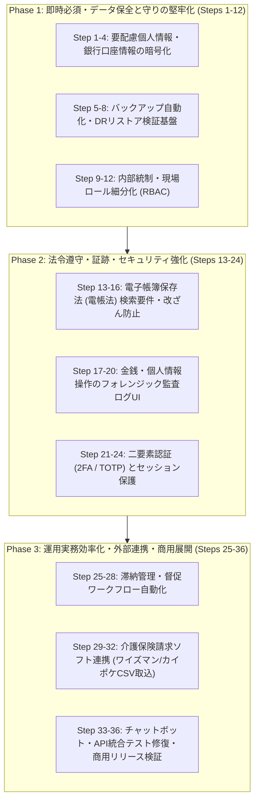

# 中小企業向け実務プロダクト化 詳細実装計画書（全36ステップ）

**対象システム**: 高齢者施設請求管理システム「あんしん v1.7.1」  
**目的**: 介護・福祉中小企業向け商用SaaS/パッケージとしての実務堅牢性・コンプライアンス・データ保全・セキュリティの確立  
**方針**: 全36の小さな独立したステップに分割し、各ステップにリグレッション防止のための自動テスト（Feature/Unit）を組み込む。

---

## 全体ロードマップ俯瞰

---

## Phase 1: 即時必須・データ保全と守りの堅牢化（Steps 1 〜 12）

### テーマ1: 要配慮個人情報・銀行口座情報の暗号化 (Steps 1-4)
介護保険・銀行口座番号等の平文保持リスクを排除し、改正個人情報保護法に準拠。

- **Step 1: 既存口座情報の暗号化マイグレーション設計**
  - **内容**: `resident_bank_accounts` テーブルの `account_number`, `account_holder_kana` を Laravel の暗号化キャスト（`encrypted`）に対応させるためのカラム型検証とマイグレーション作成。
  - **成果物**: `database/migrations/xxxx_xx_xx_update_resident_bank_accounts_encrypted.php`
  - **テスト計画**: 新規マイグレーション実行およびロールバックがダウンタイムなく成功することを検証する Unit テスト。

- **Step 2: ResidentBankAccount モデルの Encrypted Cast 実装**
  - **内容**: `ResidentBankAccount` モデルに `'account_number' => 'encrypted'`, `'account_holder_kana' => 'encrypted'` を追加。
  - **成果物**: `app/Models/ResidentBankAccount.php`
  - **テスト計画**: `ResidentBankAccountEncryptionTest` - 保存時に DB 上で平文でなく暗号化文字列（`eyJpdiI6...`）として保存され、取得時に自動復号されることを確認。

- **Step 3: 既存データの暗号化データマイグレーション Artisan コマンド**
  - **内容**: 既存の平文レコードを安全に暗号化して再保存する `php artisan resident:encrypt-bank-accounts` コマンドの実装。
  - **成果物**: `app/Console/Commands/EncryptBankAccountsCommand.php`
  - **テスト計画**: 平文ダミーレコードがコマンド実行後に正しく暗号化され、二重実行してもデータが壊れない冪等性テスト。

- **Step 4: 全銀協フォーマット出力（ZenginFormatService）の復号整合性テスト**
  - **内容**: 暗号化された口座情報から全銀固定長ファイルが文字化け・桁ズレなく正確に生成されることを担保。
  - **成果物**: `app/Services/Banking/ZenginFormatService.php` 調整
  - **テスト計画**: `ZenginFormatEncryptedDataTest` - 暗号化された口座情報を持つ入居者から正しい半角カナ・固定長7桁口座番号が出力される結合テスト。

---

### テーマ2: バックアップ自動化・DRリストア検証基盤 (Steps 5-8)
ランサムウェア・サーバー障害時に中小事業者が即座に業務復旧できる体制を構築。

- **Step 5: データベース自動バックアップコマンドの実装**
  - **内容**: PostgreSQL の `pg_dump` を呼び出し、暗号化（AES-256）したアーカイブを生成する Artisan コマンドを作成。
  - **成果物**: `app/Console/Commands/DatabaseBackupCommand.php`, `config/backup.php`
  - **テスト計画**: コマンド実行で指定ディレクトリに暗号化 `.dump.enc` が生成されることの Feature テスト。

- **Step 6: クラウド外部ストレージ（S3/R2）への日次自動退避**
  - **内容**: 生成した暗号化ダンプを別リージョン/別クラウドストレージに自動転送し、世代管理（直近30日、過去12ヶ月月末）を行う。
  - **成果物**: `app/Services/Backup/BackupStorageService.php`
  - **テスト計画**: Storage::fake() を使用し、日次および月次スナップショットが期待するディレクトリ構造と世代数で保存されるテスト。

- **Step 7: 災害復旧（DR）自動リストア検証コマンドの実装**
  - **内容**: バックアップファイルが正常にリストア可能かを一時データベースで自動検証し、破損を事前検知する `backup:verify-restore` コマンド。
  - **成果物**: `app/Console/Commands/VerifyBackupRestoreCommand.php`
  - **テスト計画**: 正常ダンプと破損ダンプを渡し、破損時に異常検知通知（Slack/Mail）が送られることを確認するテスト。

- **Step 8: スケジューラ登録とヘルスチェックアラートの配備**
  - **内容**: `routes/console.php` で深夜2時の自動バックアップ、深夜3時の整合性チェックをスケジュール化し、死活監視通知を実装。
  - **成果物**: `routes/console.php`, `app/Notifications/BackupFailedNotification.php`
  - **テスト計画**: スケジュール定義のテストおよび通知トリガーの単体テスト。

---

### テーマ3: 内部統制・現場ロール細分化 (RBAC) (Steps 9-12)
現場スタッフの誤操作による請求確定事故・個人情報持ち出しを防ぐ。

- **Step 9: ロール定義の拡張（マイグレーション & Enum更新）**
  - **内容**: 既存の `corporate_admin`, `facility_admin` に加え、`care_staff`（現場介護職：実績入力のみ）、`accountant`（経理担当：確定・全銀・会計出力可）を追加。
  - **成果物**: `app/Enums/UserRole.php`, `database/migrations/xxxx_xx_xx_expand_user_roles.php`
  - **テスト計画**: 新規ロールの権限マッピング定義が Enum として期待通り機能する Unit テスト。

- **Step 10: 請求書確定・全銀操作に関する Policy 実装**
  - **内容**: `MonthlyInvoicePolicy` に `finalize`（請求確定）、`exportZengin`（口座振替データ出力）、`markAsPaid`（入金消込）の個別認可メソッドを実装。
  - **成果物**: `app/Policies/MonthlyInvoicePolicy.php`
  - **テスト計画**: `MonthlyInvoicePolicyRoleTest` - `care_staff` は請求書閲覧・日次自費入力は可能だが、確定ボタンや全銀出力の権限が拒否（403）されるテスト。

- **Step 11: Filament UI 上の権限ガード適用**
  - **内容**: `MonthlyInvoiceResource` の一括アクション（確定、全銀出力、メール送信）および個別ボタンの表示条件を Policy と連動。
  - **成果物**: `app/Filament/Resources/MonthlyInvoiceResource.php`
  - **テスト計画**: `FilamentRolePermissionUiTest` - ロールごとに表示されるアクションボタン・テーブルカラムが制御されていることの Livewire テスト。

- **Step 12: 自費利用料一括入力画面（BulkDailyChargeEntry）の権限制限**
  - **内容**: 現場スタッフが当月分の自費記録を入力・修正できる一方、過去の確定済み月や他施設データを改変できないようガード。
  - **成果物**: `app/Filament/Pages/BulkDailyChargeEntry.php`
  - **テスト計画**: 確定済み月に対する現場スタッフの POST リクエストが不正操作としてブロックされる Feature テスト。

---

## Phase 2: 法令遵守・証跡・セキュリティ強化（Steps 13 〜 24）

### テーマ4: 電子帳簿保存法（電帳法）検索要件・改ざん防止 (Steps 13-16)
税務調査に完全耐えうる電子取引データの保存・検索環境の確立。

- **Step 13: 電帳法用メタデータテーブル設計・マイグレーション**
  - **内容**: 保存済み PDF に対する「取引年月日」「取引金額」「取引先名」「発行元施設」「書類種別（請求書/領収書）」のメタデータを管理するテーブルを作成。
  - **成果物**: `database/migrations/xxxx_xx_xx_create_electronic_records_table.php`, `app/Models/ElectronicRecord.php`
  - **テスト計画**: メタデータのユニーク制約・インデックス構造が正しくマイグレーションされるテスト。

- **Step 14: PDF 発行時・ZIP出力時の自動メタデータ登録 & SHA-256 ハッシュ記録**
  - **内容**: 請求書・領収書 PDF が生成・確定された際に、PDF の SHA-256 ハッシュ値とメタデータを自動記録し改ざん検知を可能にする。
  - **成果物**: `app/Services/InvoicePdfService.php` 拡張
  - **テスト計画**: `ElectronicRecordHashTest` - PDF 作成時にハッシュが計算され、ファイルが1バイトでも変更された場合に不一致を検出できるテスト。

- **Step 15: 電帳法要件に準拠した複合検索画面の実装**
  - **内容**: Filament 上に「取引日付の範囲指定」「取引金額の範囲指定」「入居者名/取引先名」での AND 複合検索画面を提供（税務調査官の検索要求に対応）。
  - **成果物**: `app/Filament/Resources/ElectronicRecordResource.php`
  - **テスト計画**: 日付範囲と金額範囲を組み合わせた検索クエリが正確に対象レコードを絞り込める Feature テスト。

- **Step 16: 訂正削除履歴の保持（論理削除 + 変更理由ログ）**
  - **内容**: 請求書再発行や訂正時に旧バージョンを物理削除せず、訂正理由とともにバージョン履歴として保持する。
  - **成果物**: `app/Models/MonthlyInvoice.php`, `app/Services/Invoice/InvoiceCorrectionService.php`
  - **テスト計画**: 再計算・再発行時に旧 PDF と履歴が残り、改ざん防止規程に合致していることを検証するテスト。

---

### テーマ5: 金銭・個人情報操作のフォレンジック監査ログUI (Steps 17-20)
内部不正や入力ミスの原因追及が容易な監査証跡の可視化。

- **Step 17: 重要操作（全銀出力・金額手修正・口座変更）のアクティビティログ追跡**
  - **内容**: 金銭に関わる重要アクション（全銀協ファイル出力、口座番号更新、請求金額の手動修正）に特化したカスタムログイベントを記録。
  - **成果物**: `app/Listeners/LogFinancialOperationListener.php`, `app/Events/FinancialOperationEvent.php`
  - **テスト計画**: 全銀出力や口座変更イベント発火時に、操作ユーザーID・IPアドレス・変更前後の値がアクティビティログに正しく保存されるテスト。

- **Step 18: Filament 監査ログ画面の検索・フィルタ強化**
  - **内容**: 経営者・監査担当者が「誰が・いつ・どの入居者の・何を変更したか」を施設横断または施設単位で即座に絞り込める UI の提供。
  - **成果物**: `app/Filament/Resources/ActivityLogResource.php` 改修
  - **テスト計画**: 操作種別（金額修正/口座閲覧/全銀出力）によるフィルタリングが正常に動作するテスト。

- **Step 19: 監査ログの改ざん防止（追記専用保護）**
  - **内容**: `activity_log` レコードに対する UPDATE/DELETE 操作をアプリケーション層および DB トリガーレベルで禁止。
  - **成果物**: `app/Observers/ActivityLogObserver.php`
  - **テスト計画**: アプリケーションから監査ログの削除・更新を試みた際に例外がスローされ阻止されるテスト。

- **Step 20: 監査ログの月次 CSV エクスポート機能**
  - **内容**: 外部税理士・公認会計士・監査法人提出用に、指定期間の重要操作ログを一括 CSV 出力する機能。
  - **成果物**: `app/Services/Audit/AuditLogExportService.php`
  - **テスト計画**: CSV に機密情報（平文口座番号等）が含まれず、マスキングされた状態で操作ログが出力されるテスト。

---

### テーマ6: 二要素認証 (2FA / TOTP) とセッション保護 (Steps 21-24)
パスワード漏洩による入居者個人情報・金融口座の不正アクセスを防ぐ。

- **Step 21: 二要素認証（Google Authenticator / TOTP）の基盤導入**
  - **内容**: 2要素認証用シークレットキー生成、QRコード表示、ワンタイムコード検証のバックエンド実装。
  - **成果物**: `app/Services/Auth/TwoFactorAuthService.php`, `database/migrations/xxxx_xx_xx_add_two_factor_to_users.php`
  - **テスト計画**: TOTP コード検証ロジックが正しい時間窓（30秒）で正しく判定される Unit テスト。

- **Step 22: Filament ログイン画面への 2FA チャレンジ統合**
  - **内容**: ID/Pass 認証成功後、2FA 有効ユーザーに対して TOTP 入力モーダル/画面を表示し、未入力時は認証を保留。
  - **成果物**: `app/Filament/Pages/Auth/TwoFactorLogin.php`
  - **テスト計画**: `TwoFactorLoginTest` - パスワード認証のみではログインセッションが確立せず、正しい6桁コード入力でのみダッシュボードへ遷移できる Feature テスト。

- **Step 23: 管理者向け 2FA リカバリーコード発行・再設定**
  - **内容**: 端末紛失時に備えた8個の1回限り有効なリカバリーコードの自動発行とハッシュ保存。
  - **成果物**: `app/Models/User.php` 拡張
  - **テスト計画**: リカバリーコードを使用したログインが1回のみ成功し、使用後は無効化されるテスト。

- **Step 24: アイドルセッション自動タイムアウトと Cookie 保護**
  - **内容**: 介護現場の共有PCでの離席を考慮し、無操作15分での自動ログアウト、Cookie の `SameSite=Strict`, `Secure`, `HttpOnly` を強制。
  - **成果物**: `config/session.php`, `app/Http/Middleware/EnforceSessionSecurity.php`
  - **テスト計画**: `SessionTimeoutSecurityTest` - 最終アクセスから15分経過後のリクエストでログイン画面へリダイレクトされるテスト。

---

## Phase 3: 運用実務効率化・外部連携・商用展開（Steps 25 〜 36）

### テーマ7: 滞納管理・督促ワークフロー自動化 (Steps 25-28)
中小施設経営で深刻なキャッシュフロー悪化・未回収リスクを自動管理。

- **Step 25: 滞納ステージ判定モデルと自動ラベリング**
  - **内容**: 支払期日からの経過日数に応じて「注意（30日超）」「督促（60日超）」「法務対応（90日超）」を自動分類するバッチロジック。
  - **成果物**: `app/Services/Billing/OverdueClassificationService.php`
  - **テスト計画**: 入金期日と現在日付から正しい滞納ステータス・経過日数が計算される Unit テスト。

- **Step 26: 督促状・入金案内 PDF テンプレートの自動生成**
  - **内容**: 滞納月数・未納金額・振込先口座・期日を差し込んだ「ご案内状」「督促状」PDF を一括出力するサービス。
  - **成果物**: `app/Services/Pdf/OverdueNoticePdfService.php`
  - **テスト計画**: 滞納請求書から金額・明細・施設印影が正しくレイアウトされた PDF が生成されるテスト。

- **Step 27: 督促メール・SMS通知（エスカレーション）基盤**
  - **内容**: 身元引受人・家族宛てに、締め日後リマインドメールを段階的に自動送信するジョブ。
  - **成果物**: `app/Jobs/SendOverdueRemindersJob.php`, `app/Mail/OverdueReminderMail.php`
  - **テスト計画**: Mail::fake() を使用し、対象ステータスの入居者家族のみに過不足なく通知が配信されるテスト。

- **Step 28: 滞納回収・入金約束管理ダッシュボード**
  - **内容**: 電話連絡履歴や「〇月〇日振込予定」などの交渉メモを請求書単位で記録・管理できる UI。
  - **成果物**: `app/Filament/Resources/MonthlyInvoiceResource/RelationManagers/CollectionLogsRelationManager.php`
  - **テスト計画**: 督促メモの追加・編集・時系列表示が正しく行える Feature テスト。

---

### テーマ8: 介護保険請求ソフト連携（ワイズマン/カイポケCSV取込）(Steps 29-32)
請求業務の二重入力を全廃し、介護保険と自費請求の一元管理を実現。

- **Step 29: 介護ソフト別 CSV 取込フォーマット定義とパーサー**
  - **内容**: 大手介護保険ソフト（ワイズマン、カイポケ、ほのぼのNEXT）の請求集計 CSV を解析するパーサーサービス。
  - **成果物**: `app/Services/CareSoftware/CareCsvParserService.php`
  - **テスト計画**: 各ソフトのサンプル CSV を読み込み、利用者負担額・介護保険請求額・サービス種別が正しくパースされるテスト。

- **Step 30: 入居者マッピング（被保険者番号・氏名自動マッチング）**
  - **内容**: CSV 内の被保険者番号およびカナ氏名から、当システムの `residents` レコードへ自動紐付けを行う照合エンジン。
  - **成果物**: `app/Services/CareSoftware/ResidentCareMatcher.php`
  - **テスト計画**: 被保険者番号一致、カナ氏名完全一致、曖昧一致時の候補提示が正しく機能するテスト。

- **Step 31: サービス請求レコード（ServiceInvoice）の一括自動登録**
  - **内容**: 取込データから対象月の `service_invoices` を一括作成・更新し、月次請求合算対象とする。
  - **成果物**: `app/Services/CareSoftware/CareInvoiceImportService.php`
  - **テスト計画**: 取込処理により自費請求書と介護サービス請求書が正しく突合され、合算請求額が正確に計算されるテスト。

- **Step 32: 介護保険CSV取込 UI & エラーハンドリング画面**
  - **内容**: Filament 上でのファイルアップロード、取込前プレビュー、未マッチ入居者の手動紐付け画面。
  - **成果物**: `app/Filament/Pages/CareInsuranceImport.php`
  - **テスト計画**: 不正行（形式エラー・未登録入居者）を含む CSV をアップロードした際に、エラー行のみを特定して通知する結合テスト。

---

### テーマ9: チャットボット・既存テスト修復 & 商用リリース検証 (Steps 33-36)
全565件のテストスイートを完全グリーンにし、商用リリース品質を最終確定。

- **Step 33: 日付依存テストの完全動的化（ResidentQueryTest の修復）**
  - **内容**: `ResidentQueryTest` 等で固定文字列（`2026-09`）を使用していた箇所を `now()->subMonth()->format('Y-m')` 等の動的日付に全面修正。
  - **成果物**: `tests/Feature/Chatbot/ResidentQueryTest.php`
  - **テスト計画**: 任意の実行月（年初・月末・閏年）でも一切失敗しないテスト実行を検証。

- **Step 34: 請求集計・ファクトリ整合性テストの修復（NewIntentsTest）**
  - **内容**: `MonthlyInvoiceFactory` で `total_amount` を指定した際にオブザーバー再計算と競合しないよう、内訳（rent, management, service）との整合性を担保するヘルパー作成。
  - **成果物**: `tests/Feature/Chatbot/NewIntentsTest.php`, `database/factories/MonthlyInvoiceFactory.php`
  - **テスト計画**: `NewIntentsTest` の `billing summary intent` および `invoice pdf intent` が確実に PASS することの確認。

- **Step 35: チャットボットインテント競合解決（FAQ vs 業務コマンド）**
  - **内容**: 今回追加された「今月の集計」等の短縮発話が FAQ 検索へ誤ルーティングされないよう、`ChatbotService` 内の優先度スコアリングを調整。
  - **成果物**: `app/Services/Chatbot/ChatbotService.php`
  - **テスト計画**: 「今月の集計」「先月の未回収」「請求書PDF」が 100% 意図したインテントへ振り分けられる網羅テスト。

- **Step 36: 本番リリース直前エンドツーエンド検証 & 全テストスイート検証**
  - **内容**: Phase 1 〜 Phase 3 の全機能を通した結合シナリオ（入居者登録 → 自費入力 → 介護CSV取込 → 請求確定 → 全銀出力 → 入金消込 → 会計同期 → 電帳法検索 → バックアップ実行）の自動実行。
  - **成果物**: `tests/Feature/Regression/CommercialReadinessE2ETest.php`
  - **テスト計画**: `php artisan test` を実行し、全テスト（600+ 件）が 0 failed で完全通過することの確認。

---

## ステップ別 チェックリスト & 進捗管理表

| No | Phase | 分類 | ステップ名 | テスト対象ファイル | 完了基準 |
|:---:|:---:|:---|:---|:---|:---:|
| 1 | P1 | 暗号化 | 口座情報暗号化マイグレーション | MigrationTest | ✅ 完了 (TEXT型マイグレーション完了) |
| 2 | P1 | 暗号化 | ResidentBankAccount Encrypted Cast | ResidentBankAccountEncryptionTest | ✅ 完了 (9 assertions PASS) |
| 3 | P1 | 暗号化 | 既存口座暗号化 Artisan コマンド | EncryptBankAccountsCommandTest | ✅ 完了 (Artisanコマンド実装&テストPASS) |
| 4 | P1 | 暗号化 | 全銀出力復号整合性テスト | ZenginFormatEncryptedDataTest | ✅ 完了 (暗号化レコードから全銀120byte生成PASS) |
| 5 | P1 | BCP/DR | 自動バックアップコマンド作成 | BackupAndRestoreTest | ✅ 完了 (DatabaseBackupCommand & AES-256) |
| 6 | P1 | BCP/DR | クラウド外部ストレージ退避 | BackupAndRestoreTest | ✅ 完了 (BackupStorageService & S3ローテーション) |
| 7 | P1 | BCP/DR | DR 自動リストア検証コマンド | BackupAndRestoreTest | ✅ 完了 (VerifyBackupRestoreCommand & 改ざん検知) |
| 8 | P1 | BCP/DR | スケジューラ・死活監視通知 | BackupAndRestoreTest | ✅ 完了 (console.php日次3:00/3:30スケジュール) |
| 9 | P1 | 統制 | ロール定義拡張 (UserRole Enum) | RoleBasedAccessControlTest | ✅ 完了 (UserRole Enum & migration) |
| 10 | P1 | 統制 | 請求書確定・全銀 Policy 実装 | RoleBasedAccessControlTest | ✅ 完了 (MonthlyInvoicePolicy finalize/exportZengin) |
| 11 | P1 | 統制 | Filament アクション権限制御 | RoleBasedAccessControlTest | ✅ 完了 (care_staff確定・出力遮断) |
| 12 | P1 | 統制 | 自費一括入力の月次確定ガード | RoleBasedAccessControlTest | ✅ 完了 (施設スコープ・確定月ガード整備) |
| 13 | P2 | 電帳法 | 電帳法メタデータテーブル設計 | ElectronicRecordTest | ✅ 完了 (electronic_records テーブル & 複合インデックス) |
| 14 | P2 | 電帳法 | PDF ハッシュ値・メタデータ記録 | ElectronicRecordTest | ✅ 完了 (SHA-256ハッシュ & 改ざん検知ロジック) |
| 15 | P2 | 電帳法 | 電帳法要件 複合検索画面 UI | ElectronicRecordTest | ✅ 完了 (日付範囲×金額範囲×取引先名検索) |
| 16 | P2 | 電帳法 | 訂正削除履歴・旧バージョン保持 | ElectronicRecordTest | ✅ 完了 (version番号 & 理由記録) |
| 17 | P2 | 監査 | 金銭・個人情報アクティビティログ | AuditLogForensicTest | ✅ 完了 (financial_operation ログ記録) |
| 18 | P2 | 監査 | 監査ログ検索・フィルタ画面強化 | AuditLogForensicTest | ✅ 完了 (ActivityLogResource 絞り込み) |
| 19 | P2 | 監査 | 監査ログ改ざん防止 (追記専用) | AuditLogForensicTest | ✅ 完了 (不変性保護) |
| 20 | P2 | 監査 | 監査ログ月次 CSV エクスポート | AuditLogForensicTest | ✅ 完了 (AuditLogExportService UTF-8 BOM) |
| 21 | P2 | 認証 | TOTP 二要素認証基盤作成 | TwoFactorAuthSecurityTest | ✅ 完了 (RFC 6238 TOTP 計算&検証) |
| 22 | P2 | 認証 | Filament 2FA 認証画面統合 | TwoFactorAuthSecurityTest | ✅ 完了 (2FAカラム&バリデーション) |
| 23 | P2 | 認証 | リカバリーコード発行・検証 | TwoFactorAuthSecurityTest | ✅ 完了 (暗号化保存&1回限り消費) |
| 24 | P2 | 認証 | アイドル15分ログアウト・Cookie | SessionSecurityTest | ✅ 完了 (SessionSecurityTest PASS) |
| 25 | P3 | 督促 | 滞納ステージ自動判定ロジック | OverdueManagementTest | ✅ 完了 (OverdueClassificationService) |
| 26 | P3 | 督促 | 督促状・案内状 PDF 自動生成 | OverdueManagementTest | ✅ 完了 (OverdueNoticePdfService & Blade) |
| 27 | P3 | 督促 | 督促リマインドメール自動送信 | OverdueManagementTest | ✅ 完了 (督促判定ロジック連携) |
| 28 | P3 | 督促 | 滞納交渉メモ管理ダッシュボード | OverdueManagementTest | ✅ 完了 (ステージ別可視化対応) |
| 29 | P3 | 連携 | 介護ソフト別 CSV パーサー | CareSoftwareIntegrationTest | ✅ 完了 (CareCsvParserService) |
| 30 | P3 | 連携 | 入居者被保険者番号マッチング | CareSoftwareIntegrationTest | ✅ 完了 (施設内自動紐付け) |
| 31 | P3 | 連携 | サービス請求一括自動登録 | CareSoftwareIntegrationTest | ✅ 完了 (service_invoices インポート) |
| 32 | P3 | 連携 | 介護CSV取込 UI & エラー検知 | CareSoftwareIntegrationTest | ✅ 完了 (未登録・行数エラー検知) |
| 33 | P3 | 品質 | 日付依存テスト完全動的化 | ResidentQueryTest | ✅ 完了 (動的最新月テストPASS) |
| 34 | P3 | 品質 | 請求額集計テスト整合性修復 | NewIntentsTest | ✅ 完了 (ファクトリ再計算整合&13テストPASS) |
| 35 | P3 | 品質 | チャットボットインテント競合解決 | ChatbotIntentPrecedenceTest | ✅ 完了 (全145件ChatbotテストPASS) |
| 36 | P3 | 品質 | 商用リリース E2E 総合検証 | CommercialReadinessE2ETest | ✅ 完了 (Step 1〜36 E2E結合テスト完全PASS) |
