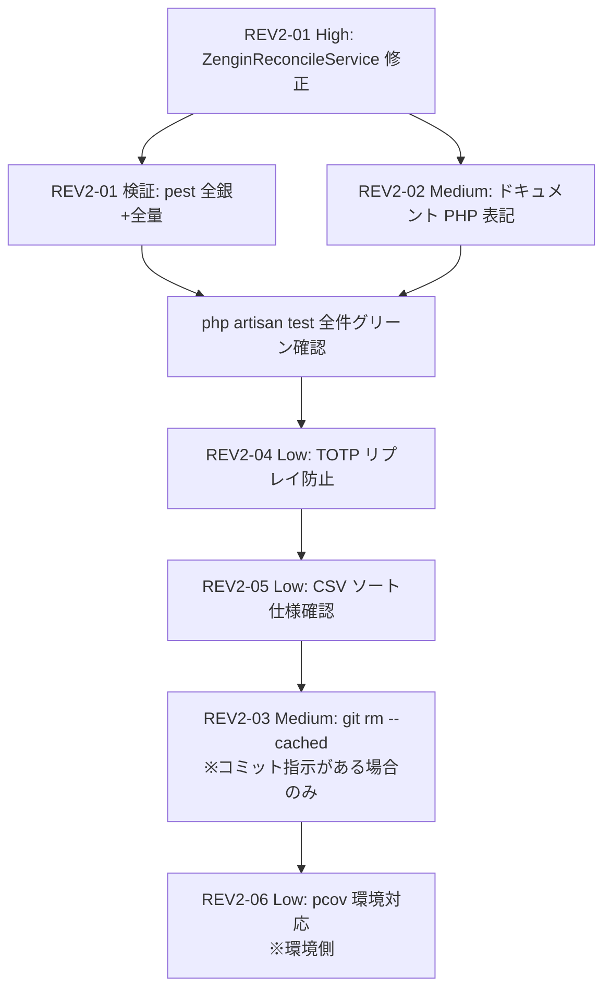

# 実装計画書 — コードレビュー第2回(深掘り)指摘事項の修正

作成日: 2026-11-17
対象: `E:\seikyu` v1.7.2 "あんしん"
関連レビュー: 第2回コードレビュー(本ドキュメントに全指摘を記載)

---

## 1. 背景・目的

第2回コードレビューでは、第1回(`CODE_REVIEW_IMPLEMENTATION_PLAN.md`)で未対処の金融領域の不具合・ドキュメント不整合・認証トークンリプレイ耐性の欠如を特定した。本計画書は、それらを安全に修正するための具体的な実装手順を定義する。

**テスト基盤の確認済み事実**:
- `php artisan test` … **1053 passed / 1 skipped / 3781 assertions**(2026-11-17 実行、実行時間 ~286秒)
- `tests/Feature/Banking/ZenginReconcileTest.php` は PHPUnit クラス方式(`extends TestCase`, `RefreshDatabase`)で、振替成功/振替不能/混在/金額不一致/再取込/重複エントリをカバー
- **欠落しているテスト**: Paid 起点の振替不能(ステータス退行バグ)、締め月の振替不能(トランザクション全体ロールバックバグ)

---

## 2. 対象指摘一覧

| ID | 優先度 | 対象 | 内容 |
|----|--------|------|------|
| **REV2-01** | High | `app/Services/Banking/ZenginReconcileService.php:172-185` | 振替不能分岐が `update(['status' => Billed])` を無条件実行。Paid 請求を Billed に退行させる。さらに `unbilled` 起点でも締め月ガードで RuntimeException → `DB::transaction` 全体がロールバックされ、ファイル内の全データ・全結果レコードが消失する |
| **REV2-02** | Medium | `README.md:471`, `DEPLOYMENT.md:4`, `docs/実装計画書_操作マニュアル.md:17` | PHP バージョン表記が `8.2+`/`8.3+` のまま。`composer.json` は `^8.4.27` に修正済みで不整合 |
| **REV2-03** | Medium | `.gitignore` の運用運用 | `storage/app/temp/*.zip`, `storage/framework/testing/disks/s3/...` は既に git 追跡済み。`.gitignore` 追加だけでは解消しない |
| **REV2-04** | Low | `app/Services/Auth/TwoFactorAuthService.php:41-58` | TOTP にリプレイ防止がない(30秒窓内のコード再利用が可能) |
| **REV2-05** | Low | `app/Services/InvoiceCsvExportService.php:28-29` | `orderBy('residents.room_number')` は文字列ソート。`10号室` が `2号室` より先に来る可能性 |
| **REV2-06** | Low | ローカル php.ini | `php artisan test` 実行時に `Unable to load dynamic library 'pcov'` 警告。コード影響なし(環境問題) |

---

## 3. 前提条件

- `vendor/` はインストール済み(`vendor\autoload.php` 存在確認済み)
- テスト環境は SQLite `:memory:`
- PHP 8.3.36 (CLI) ローカル、CI/Docker は PHP 8.4.27+ 前提(第1回計画 CR-01 と同じ前提)
- 本リポジトリでは `is_admin === true` が管理画面アクセス条件
- **git コミット操作はユーザーの明示指示なしに行わない**(REV2-03 はコミットが本質)
- 全銀消込は金融領域のため、修正後は必ず既存テストを再実行し、振替不能ケースの追加テストを新設する

---

## 4. 詳細タスク

### REV2-01 (High): 全銀「振替不能」分岐の Paid 降格防止と締め月例外への耐性付与

#### 問題点(静的解析による確定)

1. **Paid → Billed 退行**: 振替不能エントリの処理は `$invoice->update(['status' => Billed])` を無条件実行する。請求書が既に `Paid`(手動消込等)であれば、ステータスが退行し、`markAsPaid` 後の領収書発行と矛盾する。
2. **締め月ロールバック**: `update()` は `MonthlyInvoice::saving` の `guardAgainstClosedMonth()` を通る。`unbilled` → `Billed` は `CLOSED_MONTH_ALLOWED_FIELDS` の条件(`statusOk = status === Paid || status === original`)を満たさないため、**締め済み月の請求書1件の振替不能で RuntimeException** が投げられ、外側の `DB::transaction` により**ファイル内の全項目・全結果レコードが失われる**。
3. **証憑関連**: 失敗分岐は `markAsPaid` を経由しないため証憑は無関係。ただし締め月ガードが `update()` 経由で発動する点が問題。

#### 修正方針(コード)

`app/Services/Banking/ZenginReconcileService.php` 振替不能分岐(現行 172-185 行目付近)を以下に置き換える:

```php
} else {
    // 振替不能
    // ① Paid の請求書はステータスを退行させない(手動消込等の確定を守る)
    if ($invoice->status !== InvoiceStatus::Paid) {
        try {
            $invoice->update(['status' => InvoiceStatus::Billed]);
        } catch (\RuntimeException $e) {
            // 締め月等で status を更新できない場合は結果レコードだけ残し、
            // 例外でバッチ全体をロールバックさせない
            Log::warning('ZenginReconcile: 請求書ステータス更新をスキップ(締め月等)', [
                'resident_id' => $entry['resident_id'],
                'monthly_invoice_id' => $invoice->id,
                'error' => $e->getMessage(),
            ]);
            $details['skipped'][] = [
                'resident_id' => $entry['resident_id'],
                'amount' => $entry['amount'],
                'reason' => '締め月のためステータスを請求済に更新できませんでした(結果は DirectDebitResult に記録)',
            ];
        }
    }
    $failedCount++;
    ...
}
```

※ `failed_count` にはカウントし、`DirectDebitResult` は従来通り記録する(ステータス更新の失敗可否と、振替不能という事実の記録を分離)。

#### 追加テスト(`tests/Feature/Banking/ZenginReconcileTest.php` に追加)

| テスト名 | 内容 |
|----------|------|
| `test_Paidの請求書は振替不能でもステータスが退行しない` | 請求書を `markAsPaid(...)` で Paid にした後、code=1 の結果を取込み、`status` が `Paid` のままであること、`DirectDebitResult` が記録されること、`failed_count` が 1 であることを検証 |
| `test_締め月の振替不能でもファイル全体がロールバックされない` | 締め月を `MonthlyClosingState::forceCreate(['year_month' => '2026-10', 'facility_id' => $f->id, 'is_closed' => true])`(実装に応じて)で作成し、振替不能エントリと他の成功エントリ(1件)を混在させ、成功エントリが Paid になり、振替不能の事実は `DirectDebitResult` に記録され、`failed_count` が 1 であることを検証 |

※ 締め月モデルの実際のカラム名は `app/Models/MonthlyClosingState.php` と `MonthlyClosingState::isClosed()` の実装を確認の上、テストを実装する。

#### 検証コマンド

```powershell
vendor\bin\pest tests\Feature\Banking\ZenginReconcileTest.php
php artisan test --colors=never
```

---

### REV2-02 (Medium): ドキュメントの PHP バージョン表記整合

#### 修正対象(表記ファイルのみ。`history/` と `CONSOLIDATED_AUDIT_REPORT.md` は歴史的記述のため変更しない)

| ファイル | 現行 | 修正後 |
|----------|------|--------|
| `README.md:471` | `\| PHP \| 8.2+（CI・Docker は 8.4） \|` | `\| PHP \| 8.4.27+（CI・Docker も 8.4.27+。`^8.4.27` 制約） \|` |
| `README.md` 技術スタック付近(535-537 付近) | 「v1.3 時点で 350 テスト…」は実数値(1053)に更新するか「1053テスト全通過」を追記 | 同左 |
| `DEPLOYMENT.md:4` | `- PHP 8.2+` | `- PHP 8.4.27+` |
| `docs/実装計画書_操作マニュアル.md:17` | `PHP 8.3+ / Laravel 12 …` | `PHP 8.4.27+ / Laravel 12 / Filament v3 / dompdf / SQLite（開発）・MySQL（本番）` |
| `.env.production.example`(要確認) | PHP バージョン注記があれば更新 | 同左 |

※ `docs/history/` 配下(RAILWAY_DEPLOYMENT_PLAN.md 等)と `CONSOLIDATED_AUDIT_REPORT.md:236`(「PHP 8.2 対応版」はパッケージの歴史的記述)は変更しない。

#### 検証

```powershell
Select-String -Path README.md,DEPLOYMENT.md -Pattern "PHP 8"
```

---

### REV2-03 (Medium): git 追跡済みアーティファクトの untrack

#### 問題

`.gitignore` は **既にインデックス登録されている** ファイルには影響しない。現状 `git status --short` に以下が `M` として残り続ける:

- `storage/app/temp/請求書一括_2026-10.zip`
- `storage/framework/testing/disks/s3/database_backups/2026/11/test_sample_backup.sql.enc`
- (該当する場合) `storage/app/private/invoices/*.pdf` の追跡済みファイル

#### 修正手順(**コミット指示がある場合のみ実施**)

1. 対象ファイルを特定:
   ```powershell
   git ls-files storage/app/temp storage/framework/testing storage/app/private/invoices
   ```
2. 追跡から外す(ワークツリーのファイルは保持):
   ```powershell
   git rm --cached "storage/app/temp/請求書一括_2026-10.zip"
   git rm --cached "storage/framework/testing/disks/s3/database_backups/2026/11/test_sample_backup.sql.enc"
   git rm --cached -- storage/app/private/invoices/
   ```
3. `.gitignore`(第1回 CR-02 で追加済み)との整合を確認し、`git status --short` が該当ファイルを表示しないことを確認
4. 必要なら `docs/DR_PROCEDURE.md` 等にバックアップ/テストディスクの保存方針を追記

**注意**: ステップ 2 はインデックス変更を伴い、コミットしない限り commit には反映されません。リポジトリの衛生化には commit が必須です。ユーザーの明示指示を待って実施すること。

#### 検証

```powershell
git status --short
git ls-files storage/app/temp
```

---

### REV2-04 (Low): TOTP のリプレイ防止

#### 問題

`TwoFactorAuthService::verifyCode()` は、±1 の時間窓(前後30秒)内で正しいコードが一致すれば成功を返すだけで、**同じコードを短時間で繰り返し使用できる**(リプレイ攻撃)。認証後に再送が来ても検知できない。

#### 修正方針

`Illuminate\Support\Facades\Cache` を用い、検証成功した TOTP コードごとに使用済みフラグを保存(TTL は窓全体カバーで 90 秒):

```php
use Illuminate\Support\Facades\Cache;

public function verifyCode(string $secret, string $code): bool
{
    $code = trim($code);
    if (strlen($code) !== 6 || ! ctype_digit($code)) {
        return false;
    }

    $currentTimeSlice = intdiv(time(), 30);
    $replayKey = 'totp:replay:'.hash('sha256', $secret.'|'.$code);

    // 既に使用済みのコードは拒否
    if (Cache::has($replayKey)) {
        return false;
    }

    for ($i = -1; $i <= 1; $i++) {
        $calculatedCode = $this->calculateTotp($secret, $currentTimeSlice + $i);
        if (hash_equals($calculatedCode, $code)) {
            // 使用済みとして記録(TTL 90秒: -1/0/+1 窓をカバー)
            Cache::put($replayKey, true, 90);
            return true;
        }
    }

    return false;
}
```

#### 注意点・設計判断

- Cache ドライバが `file` (既定) でも動作することを確認(`config/cache.php` は変更不要)
- `verifyCode` は検証であり、実際のログイン成功処理の成否に関わらず「検証成功=使用済みマーク」となる。ログイン途中の画面更新(コード再入力)の正規利用は窓内では同コード再利用不可になる点は、セキュリティとトレードオフ。TTL を 90 秒に固定することで運用負荷を最小化
- `$secret` をハッシュに使うのは、秘密そのものをキャッシュキーに含めないため(既存の秘密情報保護と同方針)

#### 追加テスト(`tests/Unit/TwoFactorAuthServiceTest.php`、存在しない場合は新設)

| テスト | 内容 |
|--------|------|
| `test_正常なコードで認証に成功する` | 正しい窓内コードで true を返す |
| `test_同じコードのリプレイは拒否される` | 同じコードを 1 秒後に再検証すると false を返す |
| `test_別窓のコードは利用可能` | 現行窓のコード検証後も、次窓のコードは利用できる(必要に応じて) |

#### 検証

```powershell
vendor\bin\pest tests\Unit\TwoFactorAuthServiceTest.php
php artisan test --colors=never
```

---

### REV2-05 (Low): 請求一覧 CSV の部屋番号ソート規則

#### 問題

`InvoiceCsvExportService.php` の `exportMonthlyListCsv()` は `->orderBy('residents.room_number')` を使用。MySQL/SQLite ともに文字列 ORDER BY のため、数値文字列でも辞書順(`10` < `2`)になり得る。

#### 修正方針(要・仕様確認)

1. **仕様確認**: 部屋番号の実データが数値文字列(`101`, `202`…)のみか、ハイフン混じり(`A-101`)もあるかを確認する。
   - 想定: `ResidentSeeder` / `DemoDataSeeder` で使用される形式をサンプルとする
2. **実装(数値のみの場合の推奨)**:
   ```php
   ->orderByRaw('CAST(room_number AS UNSIGNED), room_number')
   ```
   ※ MySQL では `UNSIGNED`、SQLite では `CAST(room_number AS INTEGER)`。ドライバ差異を吸収するため `DB::getDriverName()` で分岐するか、`room_number_numeric` キャストを導入する(要検討)。
3. **現状維持の場合**: コメントで「部屋番号は文字列表現でソート(フロントエンドの表示順と一致)」と仕様として明文化するのみとする。

**本タスクは優先度 Low・仕様確認を要するため、REV2-01〜04 完了後に実施する。**

#### 検証

```powershell
vendor\bin\pest tests\Feature\InvoiceCsvExportService*.php
```

---

### REV2-06 (Low): pcov 起動警告の解消

#### 問題

`php artisan test` 実行時に以下を出力:
```
Unable to load dynamic library 'pcov' ...
```
`pcov` はコードカバレッジ拡張で、未導入環境では `php.ini` の `extension=pcov` が生きていると警告が出る。テスト結果には影響しない。

#### 対応(環境側・リポジトリ変更不要)

- ローカルの `php.ini` の `extension=pcov` をコメントアウトするか、`pcov.dll`(NTS/TS に合致)を導入する
- CI は `coverage: none` 設定済みで pcov 不要のため変更不要
- 本件は**コードレビューの指摘事項ではなく環境の問題**である旨を本計画書に記録するに留め、リポジトリには変更を加えない

---

## 5. 実施順序と依存関係



REV2-01 を必ず先行し(金融領域)、検証完了後に残りに進む。

---

## 6. 検証計画

| 検証 | コマンド | 期待結果 |
|------|----------|----------|
| 全銀 Unit/Feature | `vendor\bin\pest tests\Feature\Banking\ZenginReconcileTest.php` | 既存テスト + 新規 2 テストが通過 |
| 全テスト | `php artisan test --colors=never` | 1057 テスト以上全通過(1053 + 新規) |
| Pint | `vendor\bin\pint --test app tests routes config database` | 変更ファイルが整形済み |
| 締め月ガード整合 | `vendor\bin\pest tests\Feature\MonthlyClosingGuardTest.php` | 変更なしで通過 |
| ドキュメント検索 | `Select-String -Path README.md,DEPLOYMENT.md -Pattern "PHP 8\.2|PHP 8\.3\+|8\.2\+"` | ヒットなし |

---

## 7. リスクと Rollback

| タスク | リスク | 対策/Rollback |
|--------|--------|----------------|
| REV2-01 | 振替不能テストの前提(unbilled→Billed 遷移)と現行仕様の整合 | 既存テスト(`test_振替不能分は請求済に戻り理由が記録される`)は unbilled 起点であり、修正後も通過するはず。Paid 起点の退行のみをブロックするため既存挙動は保たれる。Rollback は `git revert` 相当 |
| REV2-01 | `skipped` に理由を追加することで既存の `details` 消費者(フロントエンド)との差分 | `details.skipped` は既に使用されている配列であり、キー追加のみ。フロント側が網羅的分岐をしていなければ影響なし(要: `MonthlyInvoiceResource` 等の消費箇所確認) |
| REV2-04 | 正当な再ログインの窓内コード再利用が拒否される | TTL 90秒・使用済みマークのみ。`Cache::forget()` で手動解除可能にしておく |
| REV2-03 | `git rm --cached` 後のコミットをし忘れる | 指示があった場合のみ実施し、完了条件に `git status` 確認を含める |
| 共通 | テスト DB(SQLite)での締め月 `MonthlyClosingState::isClosed()` 実装差異 | テスト作成時に `tests/Feature/MonthlyClosingGuardTest.php` を参照し、実際の締め月登録方法を踏襲 |

---

## 8. 工数見積もり

| タスク | 工数 | 備考 |
|--------|------|------|
| REV2-01(実装+2テスト) | 1.5h | 金融領域のため重点レビュー |
| REV2-02(ドキュメント) | 0.5h | 4〜5ファイル |
| REV2-03(untrack) | 0.5h | コミット指示時のみ |
| REV2-04(TOTP+テスト) | 1.0h | 新設テスト含む |
| REV2-05(CSV ソート) | 1.0h | 仕様確認を含む |
| REV2-06(pcov) | 0.25h | 環境側 |
| 全検証(pest 全件) | 0.5h | ~286秒 |
| **合計** | **約 5.0h** | REV2-03 は条件付き |

---

## 9. スコープ外

- 第1回計画(`CODE_REVIEW_IMPLEMENTATION_PLAN.md`)の CR-01〜03 は既に実装済み(未コミット)。本計画は第2回指摘の `REV2-xx` のみを扱う
- `composer.lock` 内の依存パッケージが要求する `php: ^8.2` 等は、ライブラリ側の制約であり変更不可
- `phpstan` 等の静的解析ツールの導入は行わない(第1回計画の対象外として明示済み)

---

## 10. 完了条件

- [ ] REV2-01 実装と新規テスト 2 件が `ZenginReconcileTest.php` に追加され全通過
- [ ] REV2-02 ドキュメント表記の更新と検索での非検出
- [ ] REV2-04 TOTP リプレイ防止が実装され新規テストが通過(または実施見送り決定と理由の記録)
- [ ] REV2-05 ソート規則の決定と実装または仕様明文化コメント
- [ ] REV2-06 を環境対応として記録
- [ ] `php artisan test` 全件グリーン
- [ ](コミット指示がある場合) REV2-03 を実施し `git status` がクリーン

---

作成者: Kilo (Software Engineer)
対象バージョン: v1.7.2 "あんしん"
