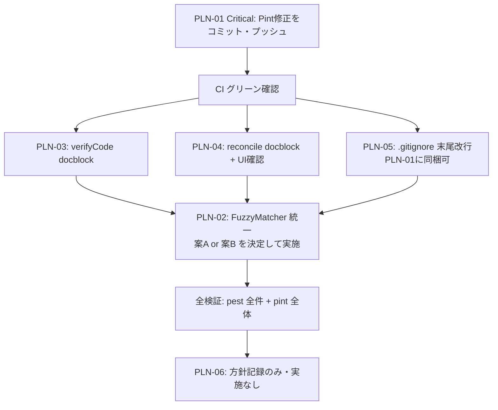

# 実装計画書 — 差分レビュー(第3回)指摘事項の修正

作成日: 2026-11-18
対象: `E:\seikyu` v1.7.2 "あんしん"
レビュー対象コミット: `ac3a1ac`（origin/master プッシュ済み）
前提: 差分レビューの結果、**CI の code-style ジョブが現状失敗状態**であることが判明

---

## 1. 背景・目的

コミット `ac3a1ac` の差分レビューで以下を特定した:

1. **Pint 違反がコミットに含まれ、CI が失敗する**（修正はローカル適用済み・未コミット）
2. `ResidentQueryService` の `FuzzyMatcher` 利用スタイルが統一されていない
3. TOTP の「検証成功＝コード消費」セマンティクスが文書化されていない
4. 全銀消込 `details` の締め月時 `failed`/`skipped` 重複記録が docblock 未記載
5. `.gitignore` の末尾改行なし（既存踏襲だが衛生上修正可）
6. `test_sample_backup.sql.enc` が git 履歴に残存（方針決定が必要）

**調査済み事実（本計画の根拠）**:
- `TwoFactorAuthService::verifyCode` の呼び出し元は 3 箇所のみ:
  - `TwoFactorVerifyController::verify`（:54）— 2FA 検証フローの最終ステップ
  - `TwoFactorVerifyController::disable`（:87）— 2FA 無効化の確定ステップ
  - `TwoFactorSetupController::verify`（:66）— セットアップ確認の確定ステップ
  - いずれも「検証成功＝その操作の確定」のため、**検証時にコードを消費する現行設計は妥当**
  - パスワード誤り＋TOTP 正解でコードが無駄になる懸念は**実フローでは発生しない**（パスワード認証後に 2FA ステップへ遷移するため）
- `ResidentQueryService` は `normalizeKana`（3 箇所・static 化済み）と `similarity`（4 箇所・**未 static 化**）の両方を使用
  - コンストラクタは `?FuzzyMatcher $fuzzyMatcher = null` で DI 経由なら常に解決されるため `?? new FuzzyMatcher` は実質デッドコード
- 未コミット差分は `app/Services/Auth/TwoFactorAuthService.php` の空行 1 行のみ（Pint 自動修正済み・`pint --test` passed・2FA テスト 3 件グリーン）

---

## 2. 対象タスク一覧

| ID | 優先度 | 対象 | 内容 |
|----|--------|------|------|
| **PLN-01** | Critical | `app/Services/Auth/TwoFactorAuthService.php` | Pint 修正（空行1行・適用済み）のコミット・プッシュ。**放置すると CI code-style ジョブが失敗し続ける** |
| PLN-02 | Low | `app/Services/Chatbot/FuzzyMatcher.php`, `ResidentQueryService.php` | `similarity()` も static 化し利用を全面統一するか、現状維持と方針文書化するかの決定・実施 |
| PLN-03 | Low | `app/Services/Auth/TwoFactorAuthService.php` | `verifyCode()` の docblock に「検証成功時にコードを消費する」セマンティクスを明記 |
| PLN-04 | Low | `app/Services/Banking/ZenginReconcileService.php` | `reconcile()` の `@return` docblock に締め月時の `failed`+`skipped` 重複記録セマンティクスを明記し、UI 消費側の表示を確認 |
| PLN-05 | Cosmetic | `.gitignore` | 末尾に改行を追加 |
| PLN-06 | Info | （リポジトリ方針） | `test_sample_backup.sql.enc` の履歴残存について方針決定（推奨: 現状維持） |

---

## 3. 詳細タスク

### PLN-01 (Critical): Pint 修正のコミット・プッシュ

**現状:**
- 修正はローカル適用済み（`Cache::put(...)` と `return true;` の間に空行 1 行）
- `pint --test` passed、`TwoFactorAuthSecurityTest` 3 件 passed
- **未コミット**。プッシュ済みの `ac3a1ac` に対し CI code-style ジョブが失敗する

**手順:**
```powershell
# 1. 現状確認
git status --short
git diff   # 空行1行のみであることを確認

# 2. コミット（リポジトリのスタイルに準拠）
git add app/Services/Auth/TwoFactorAuthService.php
git commit -m "style: Pint 違反を修正（TwoFactorAuthService の return 前に空行を追加）"

# 3. プッシュ
git push origin master

# 4. 検証: ローカルで pint 全体が通ること
vendor\bin\pint --test app tests routes config database
```

**完了条件:** `origin/master` に反映され、以降の CI（php-tests / code-style / website-checks）がグリーン

---

### PLN-02 (Low): FuzzyMatcher 利用スタイルの統一

**選択肢:**

| 案 | 内容 | 工数 | リスク |
|----|------|------|--------|
| **A（推奨）** | `similarity()` と `mbLevenshtein()` も static 化し、`ResidentQueryService` の 7 箇所を static 呼び出しに統一。コンストラクタの `?FuzzyMatcher $fuzzyMatcher = null` は後方互換のため残置（呼び出し元なし・実質未使用） | 1.0h | 低（pure 関数・状態なし） |
| B | 現状維持とし、クラス docblock に「normalizeKana は static、similarity はインスタンス」と現状を明記のみ | 0.25h | なし |

**案 A の実装手順:**

1. `app/Services/Chatbot/FuzzyMatcher.php`:
   ```diff
   -    public function similarity(string $a, string $b): float
   +    public static function similarity(string $a, string $b): float
   ```
   ```diff
   -        $distance = $this->mbLevenshtein($a, $b);
   +        $distance = self::mbLevenshtein($a, $b);
   ```
   ```diff
   -    private function mbLevenshtein(string $str1, string $str2): int
   +    private static function mbLevenshtein(string $str1, string $str2): int
   ```
   ※ メソッド内に `$this` 参照がないことを確認済み（stateless）

2. `app/Services/Chatbot/ResidentQueryService.php`:
   ```diff
   -        $matcher = $this->fuzzyMatcher ?? new FuzzyMatcher;
   -
            $normalizedKeyword = $matcher->normalizeKana($keyword);
   +        $normalizedKeyword = FuzzyMatcher::normalizeKana($keyword);
   ```
   - :105, :106 も同様に `FuzzyMatcher::normalizeKana(...)` へ
   - :124, :125, :127 の `$matcher->similarity(...)` を `FuzzyMatcher::similarity(...)` へ
   - コンストラクタの `?FuzzyMatcher $fuzzyMatcher = null` は**削除しない**（DI 互換維持・テストで明示注入している可能性に配慮）

3. 検証:
   ```powershell
   vendor\bin\pest tests/Unit/Chatbot/ tests/Unit/ResidentModelTest.php
   vendor\bin\pint --test app/Services/Chatbot/
   php artisan test --colors=never
   ```

**影響テスト:** `tests/Unit/Chatbot/ResidentQueryServiceTest.php`, `FuzzyMatcherTest.php`, `ResidentModelTest.php`

---

### PLN-03 (Low): `verifyCode()` の消費セマンティクス文書化

**手順:** `app/Services/Auth/TwoFactorAuthService.php` の `verifyCode()` docblock を拡張:

```php
    /**
     * TOTP コードを検証（時間窓 ±1 = 前後30秒）
     *
     * 検証に成功したコードは Cache に使用済みとして記録され、
     * 同一コードの再利用（リプレイ）は以後拒否される（TTL 90秒）。
     *
     * 呼び出し側の注意: 本メソッドは「検証成功 = コード消費」のセマンティクスを持つ。
     * 呼び出し元は、検証成功が直ちに操作の確定を意味するフロー
     * （2FA 検証・無効化・セットアップ確認）でのみ使用すること。
     */
```

**根拠:** 呼び出し元 3 箇所（verify/disable/setup）はいずれも検証成功が操作確定を意味するため、設計変更は不要。文書化のみでリスクは解消される。

**検証:** `vendor\bin\pest tests/Feature/TwoFactorAuthSecurityTest.php`

---

### PLN-04 (Low): 全銀 `reconcile()` の docblock 補完と UI 消費側確認

**手順:**

1. `app/Services/Banking/ZenginReconcileService.php` の `reconcile()` docblock `@return` を拡張:

```php
     * @return array{success_count: int, failed_count: int, mismatch_count: int, skipped_count: int, success_amount: int, failed_amount: int, mismatch_amount: int, details: array}
     *     details.skipped の reason には以下が含まれ得る:
     *     - 同一ファイル内の重複エントリ
     *     - 振替成功済み（再取込による重複をスキップ）
     *     - 同一の振替不能結果を記録済み
     *     - 締め月のためステータスを請求済に更新できませんでした
     *       （この場合は details.failed にも同一イベントが記録される。
     *        failed_count は振替不能の事実数、skipped はステータス更新の未実施数
     *        を意味するため、UI 表示時は reason で分岐して二重表示を避けること）
```

2. UI 消費側の確認: `app/Filament/Resources/MonthlyInvoiceResource.php`（全銀結果取込アクション）で `details.skipped` / `details.failed` の表示方法を確認し、reason 文字列をそのまま連結表示している場合は重複表示にならないか目視確認する。二重表示になる場合は failed 側に `status_update_skipped: true` フラグを追加する代替案を検討（本計画では docblock 記載のみ実施し、UI 変更は要否判断後に別タスク化）。

**検証:**
```powershell
vendor\bin\pest tests/Feature/Banking/ZenginReconcileTest.php
```

---

### PLN-05 (Cosmetic): `.gitignore` 末尾改行

**手順:** ファイル末尾に改行を追加（`\ No newline at end of file` 解消）。

```powershell
Add-Content -Path .gitignore -Value "" -NoNewline:$false
# またはエディタで末尾改行を追加
git diff -- .gitignore   # "\ No newline" 表記が消えたことを確認
```

PLN-01 のコミットに同梱してよい（スタイル修正のため）。

---

### PLN-06 (Info): 履歴残存バイナリの方針

**対象:** `storage/framework/testing/disks/s3/database_backups/2026/11/test_sample_backup.sql.enc`（履歴内に残存）

**推奨方針: 現状維持（文書化のみ）**
- 理由: テスト用サンプルフィクスチャ（228 バイト）であり実データではない。履歴消去（`git filter-repo` / BFG）は**force-push と全開発者の再クローンを伴う**ため、テストデータ消去のためには不釣り合い
- 将来的に機微データの混入が判明した場合のみ、以下の手順をメンテナンスウィンドウで実施:
  1. `git filter-repo --path <対象> --invert-paths` で履歴から完全除去
  2. 全員に再クローン周知、open PR のリベース
  3. GitHub サポートへの依頼（フォーク・キャッシュ除去）

**本計画では実施しない。方針決定の記録のみ。**

---

## 4. 実施順序と依存関係



PLN-01 を最優先（CI 赤の解消）。PLN-02〜05 は 1 コミットにまとめてよい（docblock・文書中心のため）。

---

## 5. 検証計画

| 検証 | コマンド | 期待結果 |
|------|----------|----------|
| Pint 全体 | `vendor\bin\pint --test app tests routes config database` | passed |
| FuzzyMatcher 関連 | `vendor\bin\pest tests/Unit/Chatbot/ tests/Unit/ResidentModelTest.php` | 全通過 |
| 2FA | `vendor\bin\pest tests/Feature/TwoFactorAuthSecurityTest.php` | 3 passed |
| 全銀 | `vendor\bin\pest tests/Feature/Banking/` | 9 passed |
| 全テスト | `php artisan test --colors=never` | 1056+ passed / 全グリーン |
| CI | プッシュ後 GitHub Actions の 3 ジョブ | 全グリーン |

---

## 6. リスクと Rollback

| タスク | リスク | 対策/Rollback |
|--------|--------|----------------|
| PLN-01 | 特になし（空行1行） | `git revert` |
| PLN-02 案A | `similarity()` の静的呼び出し漏れ（`$this->` 残存） | `php -l` + 全テストで検出。`Grep "\$matcher->"` で残存ゼロを確認してからコミット |
| PLN-03/04 | docblock のみ・挙動変更なし | なし |
| PLN-05 | なし | なし |

---

## 7. 工数見積もり

| タスク | 工数 |
|--------|------|
| PLN-01（コミット・プッシュ） | 0.25h |
| PLN-02（案A 実装） / （案B 文書化） | 1.0h / 0.25h |
| PLN-03（docblock） | 0.25h |
| PLN-04（docblock + UI確認） | 0.5h |
| PLN-05（末尾改行） | 0.1h |
| 全検証 | 0.5h |
| **合計** | **約 2.6h（案B なら 1.9h）** |

---

## 8. 完了条件

- [ ] PLN-01: Pint 修正がコミット・プッシュされ、CI 3 ジョブ全グリーン
- [ ] PLN-02: 案 A/B のいずれかを実施し、決定理由を記録
- [ ] PLN-03: `verifyCode()` docblock に消費セマンティクス明記
- [ ] PLN-04: `reconcile()` docblock 補完 + UI 消費側確認結果の記録
- [ ] PLN-05: `.gitignore` 末尾改行解消
- [ ] PLN-06: 方針（現状維持）を本計画書に記録済み
- [ ] `php artisan test` 全件グリーン / `pint --test` 全体 passed

---

作成者: Kilo (Software Engineer)
対象バージョン: v1.7.2 "あんしん"
