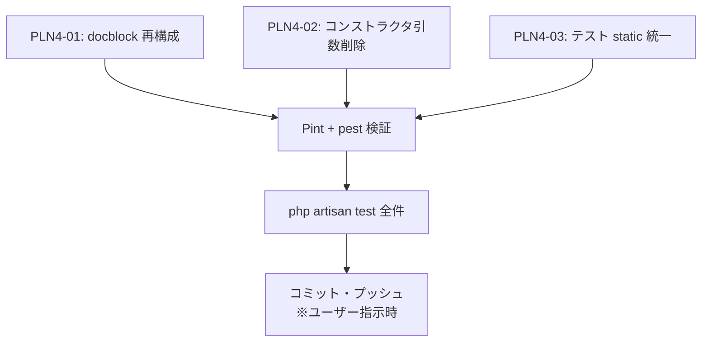

# 実装計画書 — 差分レビュー(第4回)指摘事項の修正

作成日: 2026-11-18
対象: `E:\seikyu` v1.7.2 "あんしん"
レビュー対象コミット: `63050cc`（origin/master プッシュ済み）
前提: テスト全グリーン（1056 passed / 1 skipped / 3795 assertions）。CI は本指摘では落ちない（Pint passed）が、品質上の修正が必要

---

## 1. 背景・目的

コミット `63050cc` の差分レビューで以下を特定した:

1. 🔴 `ZenginReconcileService::reconcile()` の docblock が Pint `phpdoc_align` により約170桁のパディング付きで整列され、実質読めない
2. 🟡 `ResidentQueryService` のコンストラクタプロパティ `$fuzzyMatcher` が static 化により完全未使用（デッドコード）
3. 🟡 `FuzzyMatcherTest` がインスタンス呼び出しのまま（static メソッドのインスタンス呼び出し）

**調査済み事実（本計画の根拠）**:
- `new FuzzyMatcher` の生成箇所は `tests/Unit/Chatbot/FuzzyMatcherTest.php:6`（beforeEach）のみ。app 配下にはゼロ
- `new ResidentQueryService` は引数なし 2 箇所のみ（`ResidentQueryServiceTest.php:18`, `ResidentNicknameLookupTest.php:28`）。DI による明示注入も実質なし（nullable + default null のため解決されず null）
- Pint `phpdoc_align` は **タグ（`@return` など）より後の記述を縦棒整列**する。説明段落をタグの **前** に置けば整列対象外となり崩れない
- `FuzzyMatcherTest` の全 5 テスト（similarity 4 + normalizeKana 1 + 境界値1）は static 呼び出しに置換可能

---

## 2. 対象タスク一覧

| ID | 優先度 | 対象 | 内容 |
|----|--------|------|------|
| **PLN4-01** | High | `app/Services/Banking/ZenginReconcileService.php:27-45` | docblock 再構成（説明を `@return` タグの前に移動し、約170桁パディングを解消） |
| PLN4-02 | Low | `app/Services/Chatbot/ResidentQueryService.php:17-19` | 未使用のコンストラクタ引数 `?FuzzyMatcher $fuzzyMatcher = null` を削除 |
| PLN4-03 | Low | `tests/Unit/Chatbot/FuzzyMatcherTest.php` | インスタンス呼び出しを static 呼び出しに統一（`beforeEach` 削除含む） |

---

## 3. 詳細タスク

### PLN4-01 (High): `reconcile()` docblock の再構成

**現状の問題（`63050cc` で混入）:**

```php
    /**
     * 結果ファイルを取込し、請求ステータスを自動更新する
     *
     * @param  string  $content  全銀結果ファイルの内容
     * @param  string  $yearMonth  対象請求年月 (Y-m)
     * @param  ?string  $paidAt  入金日 (Y-m-d)
     * @return array{success_count: int, ...}
     *                                              details.skipped の reason には以下が含まれ得る:   ← 約170桁パディング
     *                                              - 同一ファイル内の重複エントリ
     *                                              ...
     */
```

**修正後（説明を `@return` タグの前に独立段落として移動）:**

```php
    /**
     * 結果ファイルを取込し、請求ステータスを自動更新する
     *
     * details.skipped の reason には以下が含まれ得る:
     * - 同一ファイル内の重複エントリ
     * - 振替成功済み（再取込による重複をスキップ）
     * - 同一の振替不能結果を記録済み
     * - 締め月のためステータスを請求済に更新できませんでした
     *   （この場合 details.failed にも同一イベントが記録される。failed_count は振替不能の事実数、
     *   skipped_count はステータス更新の未実施数を意味するため、
     *   UI 表示時は reason で分岐して二重表示を避けること）
     *
     * @param  string  $content  全銀結果ファイルの内容
     * @param  string  $yearMonth  対象請求年月 (Y-m)
     * @param  ?string  $paidAt  入金日 (Y-m-d)
     * @return array{success_count: int, failed_count: int, mismatch_count: int, skipped_count: int, success_amount: int, failed_amount: int, mismatch_amount: int, details: array}
     */
```

**技術的根拠:** `phpdoc_align` は `@tag` 以降の記述（タグ行とその継続行）のみを整列対象とする。説明段落をタグより前に置くと整列対象外となり、標準の `     * ` 位置で固定される。既に `TwoFactorAuthService::verifyCode()` の docblock（`63050cc` で追加済み）がこの構成で Pint passed を確認済み。

**検証:**
```powershell
php -l app/Services/Banking/ZenginReconcileService.php
vendor\bin\pint --test app/Services/Banking/ZenginReconcileService.php
vendor\bin\pest tests/Feature/Banking/ZenginReconcileTest.php
```
追加で `git diff -- app/Services/Banking/ZenginReconcileService.php` により **パディング行が発生していないこと** を目視確認する。

---

### PLN4-02 (Low): `ResidentQueryService` の未使用コンストラクタ引数削除

**現状（`ResidentQueryService.php:17-19`）:**

```php
    public function __construct(
        private readonly ?FuzzyMatcher $fuzzyMatcher = null,
    ) {}
```

**問題:**
- static 化（`63050cc`）により `$this->fuzzyMatcher` への参照がクラス内ゼロ
- nullable + default null のため DI でも注入されず、常に null
- 生成箇所は引数なし 2 箇所のみ → **削除しても破壊的変更なし**

**修正後:**

```php
class ResidentQueryService
{
    /**
     * 施設スコープを適用した入居者検索（完全一致 → カナ一致 → 曖昧一致）
     */
    public function findResident(string $keyword, User $user): ?Resident
    {
```

（コンストラクタごと削除。プロパティ宣言も消えるため `use` 文の影響はなし — `FuzzyMatcher` は同一名前空間で明示 import 不要）

**影響確認:**
- `tests/Unit/Chatbot/ResidentQueryServiceTest.php:18` — `new ResidentQueryService`（引数なし）→ 影響なし
- `tests/Feature/Chatbot/ResidentNicknameLookupTest.php:28` — 同上 → 影響なし
- app 配下に `new ResidentQueryService(...)` なし → 影響なし

**検証:**
```powershell
php -l app/Services/Chatbot/ResidentQueryService.php
vendor\bin\pint --test app/Services/Chatbot/ResidentQueryService.php
vendor\bin\pest tests/Unit/Chatbot/ResidentQueryServiceTest.php
vendor\bin\pest tests/Feature/Chatbot/ResidentNicknameLookupTest.php
```

---

### PLN4-03 (Low): `FuzzyMatcherTest` の static 呼び出し統一

**現状:** `beforeEach` で `$this->matcher = new FuzzyMatcher;` を生成し、全テストが `$this->matcher->similarity(...)` / `$this->matcher->normalizeKana(...)` で呼び出し。

**修正後:**

```php
<?php

use App\Services\Chatbot\FuzzyMatcher;

test('完全一致は類似度1.0を返すこと', function () {
    expect(FuzzyMatcher::similarity('山田太郎', '山田太郎'))->toBe(1.0)
        ->and(FuzzyMatcher::similarity('佐藤', '佐藤'))->toBe(1.0);
});

test('1文字誤字・違いはしきい値（0.7）以上を返すこと', function () {
    // 4文字中1文字誤字: 類似度 1 - (1/4) = 0.75 >= 0.7
    expect(FuzzyMatcher::similarity('山田太朗', '山田太郎'))->toBeGreaterThanOrEqual(0.7)
        ->and(FuzzyMatcher::similarity('鈴木一郎', '鈴木一朗'))->toBeGreaterThanOrEqual(0.7);
});

test('全く違う名前はしきい値（0.7）未満を返すこと', function () {
    expect(FuzzyMatcher::similarity('田中花子', '山田太郎'))->toBeLessThan(0.7)
        ->and(FuzzyMatcher::similarity('高橋', '佐藤'))->toBeLessThan(0.7);
});

test('カナ正規化で全角半角・空白・長音が統一されること', function () {
    // 半角カタカナ -> 全角カタカナ
    expect(FuzzyMatcher::normalizeKana('ﾔﾏﾀﾞ'))->toBe('ヤマダ');

    // ひらがな -> カタカナ
    expect(FuzzyMatcher::normalizeKana('やまだ たろう'))->toBe('ヤマダタロウ');

    // 長音記号統一
    expect(FuzzyMatcher::normalizeKana('サ〜ビス'))->toBe('サービス')
        ->and(FuzzyMatcher::normalizeKana('セーラー'))->toBe('セーラー');
});

test('空文字同士または片方空文字の境界値', function () {
    expect(FuzzyMatcher::similarity('', ''))->toBe(1.0)
        ->and(FuzzyMatcher::similarity('', '山田'))->toBe(0.0);
});
```

**変更点:**
- `beforeEach` ブロック（5-7行目）を削除
- `$this->matcher->similarity(` → `FuzzyMatcher::similarity(`（8 箇所）
- `$this->matcher->normalizeKana(` → `FuzzyMatcher::normalizeKana(`（5 箇所）
- `use App\Services\Chatbot\FuzzyMatcher;` は維持

**検証:**
```powershell
php -l tests/Unit/Chatbot/FuzzyMatcherTest.php
vendor\bin\pest tests/Unit/Chatbot/FuzzyMatcherTest.php
vendor\bin\pint --test tests/Unit/Chatbot/FuzzyMatcherTest.php
```

---

## 4. 実施順序と依存関係



3 タスクは相互依存なし（並行実施可）。すべて 1 コミットにまとめてよい。

---

## 5. 検証計画

| 検証 | コマンド | 期待結果 |
|------|----------|----------|
| 構文 | `php -l`（変更 3 ファイル） | エラーなし |
| Pint（変更 3 ファイル） | `vendor\bin\pint --test ...` | passed |
| docblock 目視 | `git diff` で ZenginReconcileService | パディング行なし・標準 `     * ` 位置 |
| Chatbot Unit | `vendor\bin\pest tests/Unit/Chatbot/` | 全通過 |
| 全銀 | `vendor\bin\pest tests/Feature/Banking/ZenginReconcileTest.php` | 9 passed |
| Chatbot Feature | `vendor\bin\pest tests/Feature/Chatbot/ResidentNicknameLookupTest.php` | 全通過 |
| 全テスト | `php artisan test --colors=never` | 1056 passed / 1 skipped |
| CI | プッシュ後 3 ジョブ | 全グリーン |

---

## 6. リスクと Rollback

| タスク | リスク | 対策/Rollback |
|--------|--------|----------------|
| PLN4-01 | 再構成後に再び phpdoc_align が整列する可能性 | 検証で `git diff` 目視 + `pint --test` を実施。崩れた場合は `@return` の後に行を置かない構成を徹底 |
| PLN4-02 | 見落としている注入箇所（Service Provider 等での明示束縛） | 事前 grep で生成箇所ゼロを確認済み。万一の破綻も全テストで検出可能。Rollback は `git revert` |
| PLN4-03 | なし（テストのみ・挙動不変） | なし |

---

## 7. 工数見積もり

| タスク | 工数 |
|--------|------|
| PLN4-01（docblock 再構成 + 検証） | 0.5h |
| PLN4-02（引数削除 + 検証） | 0.25h |
| PLN4-03（テスト統一 + 検証） | 0.25h |
| 全テスト + コミット・プッシュ | 0.5h |
| **合計** | **約 1.5h** |

---

## 8. 完了条件

- [ ] PLN4-01: docblock が標準位置で整列され、`pint --test` passed
- [ ] PLN4-02: `$fuzzyMatcher` プロパティ削除、Chatbot テスト全通過
- [ ] PLN4-03: `FuzzyMatcherTest` が static 呼び出しのみで構成され全通過
- [ ] `php artisan test` 全件グリーン
- [ ] （ユーザー指示時）コミット・プッシュ完了、CI 3 ジョブ全グリーン

---

作成者: Kilo (Software Engineer)
対象バージョン: v1.7.2 "あんしん"
