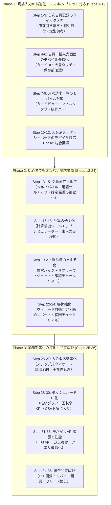
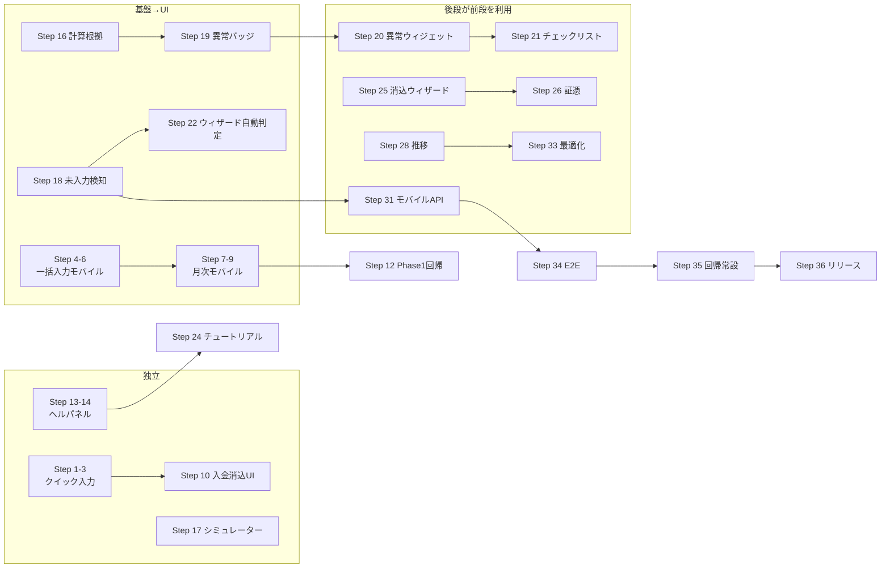

# 業務効率化・モバイル入力・初心者対応 詳細実装計画書（全36ステップ）

**対象システム**: 高齢者施設請求管理システム「あんしん v1.7.2」
**目的**: ①現場スタッフがスマホ・タブレットで**迷わず・速く**入力できること、②請求業務を**初心者でもマニュアルなしで**完遂できること、③月次請求業務全体の**工数削減**を実現する。
**方針**: 全36の小さな独立したステップに分割し、**各ステップにリグレッション防止のための自動テスト（Feature/Unit）を必ず組み込む**。既存1,011テスト（3,624アサーション）を常にグリーンに保つ。

> **本計画の前提（実装済みのため対象外とする機能）**
> 以下は既に実装済みのため本計画では再実装しない。各ステップはこれらの基盤の上に構築する。
>
> | 実装済み基盤 | 箇所 |
> |---|---|
> | モバイルAPI（自費記録POST等） | `routes/api.php` `MobileApiController` |
> | 権限ロール（care_staff / accountant 追加）・Policy | `app/Enums/UserRole.php` `app/Policies/MonthlyInvoicePolicy.php` |
> | ダッシュボードウィジェット群 | `app/Filament/Widgets/`（未入力・未請求・未入金・クイックアクション等7種） |
> | 異常値検知エンジン（前月比±30%等5ルール） | `app/Services/Billing/BillingAnomalyDetector.php` |
> | 月次締めウィザード・状態管理 | `MonthlyClosingState` `MonthlyClosingWizardTest` |
> | PDF/ZIP非同期ジョブ | `app/Jobs/GenerateInvoicePdfJob.php` `GenerateMonthlyZipJob.php` |
> | ナビゲーション業務別グルーピング・クロスリンク | `AdminPanelProvider`（docs/UI_UX_IMPLEMENTATION_PLAN.md 完了） |
> | 電帳法メタデータ・監査ログ強化 | `ElectronicRecord` `app/Services/Audit/` |

---

## 全体ロードマップ俯瞰

---

## 問題整理（現状の課題と解決の構造）

### 課題A: 現場（サ高住スタッフ）のスマホ・タブレット入力が遅い

| # | 具体的問題 | 影響 | 本計画での解決ステップ |
|---|---|---|---|
| A1 | 自費記録1件の入力に「一覧→新規→日付→入居者→品目→数量→保存」の多段操作が必要 | 1件30〜60秒、25名分で25分超 | Step 1-3 |
| A2 | 一括入力画面（`BulkDailyChargeEntry`）がPC向けテーブル設計で、スマホでは横スクロール・タッチ誤爆が多発 | 現場がPCに戻る→入力が夜に滞留 | Step 4-6 |
| A3 | 月次請求一覧は列が多く、スマホでの金額確認・一括操作が事実上不可 | 事務員がタブレットで締め作業できない | Step 7-9 |
| A4 | 入金消込モーダルがモバイルで窮屈 | 消込作業をPC作業としてブロック | Step 10 |
| A5 | モバイルAPIは単件POSTのみで一括・プリセット・照会に非対応 | タブレットのネイティブUIから使いにくい | Step 31 |

### 課題B: 請求業務が初心者に難しい

| # | 具体的問題 | 影響 | 本計画での解決ステップ |
|---|---|---|---|
| B1 | 用語（日割り・確定保護・Unbilled/Billed/Paid）が画面上に説明なし | マニュアル読み戻り・誤操作 | Step 13-14 |
| B2 | 「請求済にすると戻せない」が実行時しか分からない | 確定ミス→管理者依頼 | Step 15 |
| B3 | 日割り計算の根拠が一覧に見えない（「なぜこの金額?」） | 確認電話・確認工数 | Step 16 |
| B4 | 「入居日を変えたら請求はどうなる?」を事前試算できない | 本番データでの試行錯誤 | Step 17 |
| B5 | 自費記録の入力漏れ日が入居者単位で分からない（ウィジェットは当日のみ） | 請求漏れ・後修正 | Step 18 |
| B6 | 異常値は`BillingAnomalyDetector`が検知するが、一覧上で見えない | 検知結果を見に行かない | Step 19-21 |
| B7 | 月次締めウィザードの完了条件が手動チェック中心 | 漏れ・判断ミス | Step 22-23 |
| B8 | 初回ログイン時の導線がマニュアル参照のみ | 立ち上げ期の迷い | Step 24 |

### 課題C: 月次業務の工数が残っている

| # | 具体的問題 | 影響 | 本計画での解決ステップ |
|---|---|---|---|
| C1 | 入金消込が1件ずつモーダル操作 | 25名で15分〜 | Step 25 |
| C2 | 証憑（入金通知書等）の添付保管がない | 電帳法・監査で手作業 | Step 26 |
| C3 | 全銀不能件が通知のみで管理画面がない | 不能対応の漏れ | Step 27 |
| C4 | 推移・回収率がCSV→Excelの二次加工が必要 | 経営報告の遅れ | Step 28-29 |
| C5 | 会計CSV出力のプロファイル選択が毎回手順 | 出力ミス・手間 | Step 30 |
| C6 | 大量データ時の一覧・集計が遅い | 体感劣化・タイムアウト | Step 33 |
| C7 | リグレッションが手動頼み（E2E・モバイル回帰なし） | 改修時のデグレリスク | Step 34-36 |

---

## テスト戦略（リグレッション防止方針）

| 方針 | 内容 |
|---|---|
| **1. ステップ毎テスト込み** | 各ステップに「テスト計画」を明記。実装と同じコミットにテストを含める。 |
| **2. 既存テスト保護** | 変更対象の既存テスト（`BulkDailyChargeEntryTest` `FilamentDailyChargeResourceTest` `FilamentMonthlyInvoiceResourceTest` `MonthlyClosingWizardTest` 等）は**修正せず先に実行**して現状グリーンを確認してから着手する。 |
| **3. Livewireテスト方式** | Filament/Livewire の変更は `Livewire::test()` でレンダリング・アクション・通知まで検証（既存 `BulkDailyChargeEntryTest` の方式を踏襲）。 |
| **4. 計算はUnitに分離** | 金額計算・判定ロジックはサービスクラスに置き、Filamentから切り離してUnitテスト可能にする。 |
| **5. フェーズ完了時の全回帰** | 各Phase完了時に `php artisan test` 全実行（1,011テスト+新規）を必須とする。 |
| **6. 日本語テスト名** | 既存規約に合わせ、`test('...')` に日本語で振る舞いを記述する。 |
| **7. テスト先作成（TDD lite）** | 新規サービス・判定ロジックはテストを先に書き、実装で満たす。UI実装はレンダリング→アクション→権限の順に検証。 |

---

# 前半: Phase 1 〜 Phase 2 前半（Steps 1-18）

## Phase 1: 現場入力の高速化・スマホ/タブレット対応（Steps 1 〜 12）

### テーマ1: 日々の自費記録 クイック入力 (Steps 1-3)
1件の入力操作数を削減し、現場の「今日の記録し忘れ」をなくす。

- **Step 1: 直前入力引き継ぎサービス（QuickInputService）の実装**
  - **内容**: ログインユーザーの直近の自費記録（自身が作成した最新レコード）から「入居者・品目・単価・数量・備考」の組合せを取得し、クイック入力の初期値候補を返すサービスを作成。品目別の「よく使う備考」（例: 「午前中」「夜間交換」）も集計して上位5件を返す。
  - **成果物**: `app/Services/QuickInputService.php`
  - **テスト計画**: `tests/Unit/QuickInputServiceTest.php` — ①直近レコードなし→デフォルト値（当日・数量1）を返す ②直近レコードあり→品目・単価・備考を引き継ぐ ③自分の記録のみ対象（他人の記録を引き継がない） ④退去済入居者は候補から除外される ⑤定型備考の上位5件集計。

- **Step 2: 「続けて入力」アクションの実装（CreateDailyCharge 拡張）**
  - **内容**: `DailyChargeResource` の作成ページに「保存して続けて入力」ボタンを追加。保存成功後、**入居者・日付はクリア、品目・単価は引き継ぎ**でフォームを再表示する（連続記録モード）。加えて、`ListDailyCharges` のヘッダーに「今日の記録」クイック作成アクションを追加し、QuickInputServiceの初期値を自動セットする。
  - **成果物**: `app/Filament/Resources/DailyChargeResource/Pages/CreateDailyCharge.php`、`app/Filament/Resources/DailyChargeResource.php`（ヘッダーアクション追加）
  - **テスト計画**: `tests/Feature/Filament/DailyChargeQuickInputTest.php` — ①「保存して続けて入力」でレコードが作成されフォームが再表示される ②品目・単価が引き継がれ、入居者・日付は初期化される ③ヘッダーのクイック作成で直前品目が事前選択される ④Livewireバリデーションエラー時はフォームが保持される ⑤**既存 `FilamentDailyChargeResourceTest` が全件通過（リグレッション）**。

- **Step 3: 相対日付ボタン・定型備考チップの実装**
  - **内容**: 作成フォームの利用日フィールド下に「今日 / 昨日 / 一昨日」の相対日付ボタンをAlpine.jsで実装（タップで日付セット）。備考フィールド下に定型備考チップ（QuickInputServiceで集計した上位備考）を表示し、タップで入力。
  - **成果物**: `resources/views/filament/forms/quick-date-buttons.blade.php`、`DailyChargeResource` フォーム拡張
  - **テスト計画**: `tests/Feature/Filament/DailyChargeQuickInputTest.php` に追加 — ①相対日付ボタンがレンダリングされる ②定型備考チップがレンダリングされ、クリックで備考フィールドに反映される（Livewire `assertSet`）。手動検証: 768px幅でボタンがタッチ可能サイズ（44px以上）であること。

---

### テーマ2: 自費一括入力画面（BulkDailyChargeEntry）のモバイル最適化 (Steps 4-6)

- **Step 4: スマホ用カード型レイアウトの実装**
  - **内容**: 一括入力画面の入居者テーブルを、**768px未満ではカード型**（1名=1カード: 部屋番号+氏名+チェックボックス+数量）に切替。768px以上は現行テーブル維持。Tailwindの `md:` ブレークポイントで両レイアウトを同居させ、wire:modelのプロパティは共通化（機能差を作らない）。
  - **成果物**: `resources/views/filament/pages/bulk-daily-charge-entry.blade.php`（レスポンシブ化）
  - **テスト計画**: `tests/Feature/Filament/BulkEntryMobileLayoutTest.php` — ①カード用マークアップとテーブル用マークアップが両方レンダリングされる ②カードのチェックボックスが `entries.N.selected` にバインドされている ③数量入力が `entries.N.quantity` にバインドされている ④**既存 `BulkDailyChargeEntryTest` `BulkDailyChargeEntryPresetTest` が全件通過**。

- **Step 5: タッチターゲット拡大（数量±大型ボタン・選択改善）**
  - **内容**: カードの数量入力に「−」「＋」大型ボタン（44px以上）を追加し、テキスト入力は補助に格下げ。フロア選択ボタン・全選択/全解除ボタンも44px以上に拡大。プリセットモード時は数量操作を無効化（既存仕様を維持）。
  - **成果物**: `resources/views/filament/pages/bulk-daily-charge-entry.blade.php`、Alpine.jsコンポーネント `resources/js/bulk-entry-touch.js`（またはBlade内インライン）
  - **テスト計画**: `tests/Feature/Filament/BulkEntryMobileLayoutTest.php` に追加 — ①±ボタンで数量増減（`set('entries.0.quantity', ...)`相当のwire:model更新で金額合計が再計算される） ②数量0で保存しようとするとスキップされる（既存ガード再確認） ③プリセットモードで±ボタンがdisabled。

- **Step 6: 保存前確認サマリーモーダルの実装**
  - **内容**: 「一括保存」押下時に確認モーダルを表示: ①対象件数 ②予定合計金額 ③確定済みのためスキップされる入居者数 ④同日同品目重複でスキップされる件数（既存ロジックを保存前にプレビュー計算）。確認ボタンで初めて保存実行。
  - **成果物**: `app/Filament/Pages/BulkDailyChargeEntry.php`（`confirmSave`/`saveBulk` 分離）、同Blade
  - **テスト計画**: `tests/Feature/Filament/BulkEntryConfirmModalTest.php` — ①`confirmSave`呼び出しでモーダルが開き件数・金額が表示される ②モーダルの「保存する」で`saveBulk`が実行されレコード作成 ③キャンセルで保存されない ④確定月入居者が含まれる場合スキップ件数が表示される ⑤**既存 `BulkStatusGuardTest` 全件通過（確定月ガードのリグレッション）**。

---

### テーマ3: 月次請求一覧（MonthlyInvoiceResource）のモバイル対応 (Steps 7-9)

- **Step 7: 月次請求一覧のモバイルカードビュー実装**
  - **内容**: Filament標準テーブルに加え、768px未満で「入居者名+部屋番号」「ステータスバッジ」「税込合計（太字）」「自費小計」を縦並びカードで表示するカスタムカラム（`Stack`コンポーネント）に置換。Filament v3の `Tables\Columns\Layout\Stack` + `Split` を使用し、PCでは従来の複数列テーブルを維持（`contentGrid` でレスポンシブ切替）。
  - **成果物**: `app/Filament/Resources/MonthlyInvoiceResource.php`（カラム定義のレスポンシブ化）
  - **テスト計画**: `tests/Feature/Filament/MonthlyInvoiceMobileViewTest.php` — ①カード（Stack）構成のカラムが定義されている ②PC用テーブルカラムが維持されている ③税込合計・ステータスバッジがカードに含まれる ④**既存 `FilamentMonthlyInvoiceResourceTest` 全件通過**。

- **Step 8: ステータスクイックフィルタタブの実装**
  - **内容**: 一覧上部に「すべて / 未請求 / 請求済 / 入金済」タブを追加（件数バッジ付き）。タップでテーブルフィルタが切替わる（`ListMonthlyInvoices` にタブプロパティ+クエリスコープ追加）。
  - **成果物**: `app/Filament/Resources/MonthlyInvoiceResource/Pages/ListMonthlyInvoices.php`
  - **テスト計画**: `tests/Feature/Filament/MonthlyInvoiceMobileViewTest.php` に追加 — ①各タブで対象ステータスのみ表示される ②件数バッジが正しい ③タブ切替後にフィルタ（月・施設）が維持される ④ステータス別アクション（PDF・入金消込）がカード/行で正しく出し分けられる。

- **Step 9: モバイル一括操作バーの実装**
  - **内容**: 768px未満で画面下部に固定のアクションバーを表示: 「選択 N 件」表示+「請求済に変更」「入金消込（一括）」「PDF(ZIP)」の3ボタン。選択0件時は無効化。Filamentのbulk actionsと同一のワイヤリングを共有し、ロジック二重化しない。
  - **成果物**: 同Blade拡張 + `ListMonthlyInvoices.php`（バー用computed property）
  - **テスト計画**: `tests/Feature/Filament/MonthlyInvoiceMobileViewTest.php` に追加 — ①バーがレンダリングされ選択件数が反映される ②選択0件でボタンが無効 ③「請求済に変更」が既存一括アクションと同一挙動（確認モーダル→実行→`Billed`遷移）④確定保護により`Billed`/`Paid`は編集不可のまま（**既存ステータス遷移テスト通過**）。

---

### テーマ4: 入金消込・ダッシュボードのモバイル対応 + Phase 1 完了 (Steps 10-12)

- **Step 10: 入金消込フォームのモバイル最適化**
  - **内容**: 入金消込モーダルのフォームを再構成: ①支払方法をアイコン付き大型セレクトボタン（現金/振込/口座振替/その他）化 ②入金日に相対日付ボタン（今日/昨日）追加 ③税込請求額を目立つサイズで常時表示。既存の`markAsPaid`呼び出し・領収書日付モードロジックは**一切変更しない**（UI層のみ）。
  - **成果物**: `app/Filament/Resources/MonthlyInvoiceResource.php`（入金消込アクションのフォーム拡張）
  - **テスト計画**: `tests/Feature/Filament/PaymentRecordMobileTest.php` — ①大型セレクトで支払方法選択→消込実行→`Paid`遷移 ②領収書番号が採番される（`REC-YYYYMM-NNNN`） ③入金日未入力時のバリデーション ④**既存 `markAsPaid` 系テスト（`MonthlyInvoiceModelTest`）全件通過**。

- **Step 11: ダッシュボードのモバイル最適化（ウィジェット並び替え・縦積み）**
  - **内容**: `AdminPanelProvider` のウィジェット並び順を業務優先度順に調整（①未入力自費→②未請求→③未入金→④クイックアクション→⑤推移）。スマホ幅でウィジェットが縦積み（全幅）になるよう `columnSpan` を設定。QuickActionsWidgetのボタンをタッチ可能サイズに拡大。
  - **成果物**: `app/Providers/Filament/AdminPanelProvider.php`、`app/Filament/Widgets/QuickActionsWidget.php`
  - **テスト計画**: `tests/Feature/Filament/Dashboard/DashboardMobileLayoutTest.php` — ①全ウィジェットがダッシュボードにレンダリングされる ②並び順（優先度）が期待通り ③クイックアクションボタンのURLが正しい（既存 `QuickActionsAndWidgetsTest` を拡張保護）。

- **Step 12: Phase 1 総合回帰テスト・ビューポート検証**
  - **内容**: Phase 1全体の回帰実行。加えて、Livewireレンダリングテストに「モバイルビューポート（`User-Agent` スマホ偽装 + `assertSee` セレクタ検証）」を集約した検証スイートを作成。ここで発見された微修正（余白・崩れ）を解消し、**全テストグリーンでPhase 1完了**とする。
  - **成果物**: `tests/Feature/Filament/Mobile/Phase1MobileRegressionTest.php`、修正パッチ群
  - **テスト計画**: 上記スイートで ①日次→一括→月次→消込の主要画面がモバイルUAでもエラーなくレンダリング ②`php artisan test` 全件通過をコミット条件とする。

---

## Phase 2: 初心者でも迷わない請求業務（Steps 13 〜 24）

### テーマ5: 文脈依存ヘルプ (Steps 13-15)

- **Step 13: 画面別ヘルプパネル基盤の実装**
  - **内容**: 各主要画面（日次自費・一括入力・月次請求・入金消込・会計CSV）に折りたたみ式ヘルプパネルを追加。「この画面で何をするか」「よくある間違い」「次の工程」をBladeパーシャルとして共通化（`x-filament::section` 使用）。ヘルプ文言は `resources/views/help/` に画面別ファイルとして管理し、表示フラグはユーザーメタ（`users.help_collapsed` JSON）に記憶。
  - **成果物**: `resources/views/help/*.blade.php`、`app/View/Components/HelpPanel.php`、各リソースへの配置
  - **テスト計画**: `tests/Feature/Filament/Help/HelpPanelTest.php` — ①各主要画面でヘルプパネルがレンダリングされる ②折りたたみ状態がユーザー毎に保存・復元される ③文言ファイルが画面キーに対応 ④ヘルプ未定義画面でエラーにならない（フォールバック文言）。

- **Step 14: 用語集インラインツールチップの実装**
  - **内容**: 「日割り」「確定保護」「課税対象額」「軽減税率」「消込」等の用語をヘルパーテキスト上で`<abbr>`（タップ/ホバーで説明表示）化する共通Bladeコンポーネント `x-help.term` を作成し、主要フォーム・一覧ヘッダーに適用。用語定義は `config/glossary.php` に一元化（操作マニュアル第22章と突き合わせ）。
  - **成果物**: `config/glossary.php`、`resources/views/components/help/term.blade.php`、主要リソースへの適用
  - **テスト計画**: `tests/Feature/Filament/Help/GlossaryTermTest.php` — ①定義済み用語がtooltip付きでレンダリング ②未定義用語はプレーンテキストでフォールバック（エラーなし） ③主要画面（月次請求・税率設定）で用語が表示される ④操作マニュアルの用語集との突合スナップショットテスト（全定義が空でない）。

- **Step 15: 確定保護の視覚化（状態遷移の見える化・警告強化）**
  - **内容**: ①月次請求一覧・詳細に「未請求→請求済→入金済」のミニ状態遷移図（現在地ハイライト付き）を常設 ②「一括『請求済』に変更」の確認モーダルに「**実行後は金額の編集・削除ができなくなります**」を大きく表示し、戻し方法（管理者のみ）を明記 ③`Billed`以降の編集ボタン非表示に加え、行に鍵アイコンバッジを表示。
  - **成果物**: `resources/views/components/status-flow.blade.php`、`MonthlyInvoiceResource` モーダル・テーブル拡張
  - **テスト計画**: `tests/Feature/Filament/Invoice/StatusFlowVisualTest.php` — ①遷移図が各ステータスで現在地を正しくハイライト ②確認モーダルに警告文言が含まれる ③`Billed`/`Paid`行に鍵バッジ・編集アクション非表示 ④**既存ステータス遷移・確定保護テスト全件通過**。

---

### テーマ6: 計算の透明化 (Steps 16-18)

- **Step 16: 日割り計算根拠ツールチップ（一覧表示）の実装**
  - **内容**: 月次請求一覧の「税込合計」セルに情報アイコンを追加。ホバー/タップで「在籍日数 X日 / 月日数 Y日 / 家賃計算式 / 管理費計算式 / 自費合計 / 税率内訳」を表示（`InvoiceCalculationService`と同一式でサーバー側生成・二重計算しない）。既存のPDF計算根拠セクション（v1.3 `show_calculation_basis`）と式の単一ソース化を確認。
  - **成果物**: `app/Filament/Resources/MonthlyInvoiceResource.php`（tooltip付きカラム）、`app/Services/Invoice/BasisTextBuilder.php`
  - **テスト計画**: `tests/Unit/BasisTextBuilderTest.php` + `tests/Feature/Filament/Invoice/BasisTooltipTest.php` — ①満月在籍→「満額」表記 ②月中入居→在籍日数と式が正しい（`InvoiceCalculationServiceProrationTest` の期待値と突合）③月中退去 ④税率内訳（標準/軽減）表示 ⑤PDFの計算根拠と同一文字列になることのスナップショット比較 ⑥**既存請求計算テスト全件通過**。

- **Step 17: 請求計算シミュレーターの実装**
  - **内容**: 独立Filamentページ（「請求シミュレーション」）を新設。入力: 入居者（または「仮想入居者」）、対象月、入居日、退去日、家賃、管理費、自費合計（手動or実績取込）。出力: 在籍日数・日割り額・税額内訳・税込合計を**保存なしで即時計算**。`InvoiceCalculationService` の計算クラス群（`ProrationCalculator`/`TaxCalculator`）を再利用し、新規計算ロジックは書かない。
  - **成果物**: `app/Filament/Pages/InvoiceSimulationPage.php`、同Blade
  - **テスト計画**: `tests/Feature/Filament/Invoice/InvoiceSimulationTest.php` — ①仮想入力→即時計算結果表示（DB保存なし） ②月中入居・月中退去・月またぎの3パターンが`ProrationCalculator`単体テストと同一値 ③軽減税率品目混在ケース ④care_staffロールでは閲覧不可（`canManageBilling`ガード） ⑤シミュレーション実行がMonthlyInvoiceを一切作成しないこと（カウント0アサート）。

- **Step 18: 月次未入力日マトリクス検知の実装**
  - **内容**: 対象月の「入居者 × 日付」マトリクスで自費記録の有無を可視化するページを新設（既存`UnprocessedDailyChargesWidget`は当日のみのカウントのため、月単位の漏れ発見ができないギャップを埋める）。記録0件の入居者×日付セルを警告色表示。絞り込み: 施設・フロア・「記録ありのみ/なしのみ」。`DailyCharge`集計は1クエリで取得（N+1回避）。
  - **成果物**: `app/Filament/Pages/DailyChargeCoveragePage.php`、同Blade、`app/Services/DailyChargeCoverageService.php`
  - **テスト計画**: `tests/Unit/DailyChargeCoverageServiceTest.php` + `tests/Feature/Filament/DailyChargeCoverageTest.php` — ①記録あり日付のセルが「あり」判定 ②入居前・退去後の日付は「対象外」（警告に含めない） ③月単位の未入力件数集計 ④5名×31日でも1クエリ+定数時間で応答（クエリ数アサート） ⑤care_staffは自施設のみ閲覧。

---

# 後半: Phase 2 後半 〜 Phase 3（Steps 19-36）

## Phase 2（続き）: 初心者でも迷わない請求業務（Steps 19 〜 24）

### テーマ7: 異常値の見える化 (Steps 19-21)
`BillingAnomalyDetector`（既存・5ルール）の検知結果を「気づける場所」に出す。

- **Step 19: 前月比異常ハイライトバッジ（月次請求一覧）の実装**
  - **内容**: `BillingAnomalyDetector` の前月比±30%判定を月次請求一覧に反映。異常入居者の「税込合計」セルに「前月比 +52%」等の警告バッジを表示（前月額はDetectorと同一クエリ基準で取得）。検知は1施設・1月あたり1回の集計に限定し、行毎の重い比較クエリを避ける（ページコンポーネントで一括取得→配列参照）。
  - **成果物**: `app/Filament/Resources/MonthlyInvoiceResource/Pages/ListMonthlyInvoices.php`（異常インデックス取得）、同Resource（バッジカラム）
  - **テスト計画**: `tests/Feature/Filament/Invoice/AnomalyBadgeTest.php` — ①前月比+30%超→バッジ表示 ②閾値未満→非表示 ③前月データなし→「比較不可」非表示（誤検知なし） ④既存 `BillingAnomalyDetectorTest` の判定値と一覧バッジが一致 ⑤Detector結果キャッシュによりクエリ数が増加しない（クエリ数アサート）。

- **Step 20: 異常値サマリーウィジェット（ダッシュボード）の実装**
  - **内容**: ダッシュボードに「異常値サマリー」ウィジェットを追加: 対象月の `errors` / `warnings` 件数（Detectorの戻り値をそのまま表示）+ 重大度上位5件の概要と該当入居者へのリンク。`errors` 0件なら「整合性チェック完了」の正常表示。Detector実行結果は`Cache`に30分保存（同一月の再描画で再計算しない）。
  - **成果物**: `app/Filament/Widgets/BillingAnomalySummaryWidget.php`
  - **テスト計画**: `tests/Feature/Filament/Dashboard/BillingAnomalyWidgetTest.php` — ①エラー1件・警告2件のデータで件数表示 ②0件時の正常メッセージ ③上位5件のリンク先URLが正しい ④キャッシュヒット時にDetectorが再実行されない（モック呼び出し回数アサート） ⑤care_staffでは非表示（`canManageBilling`）。

- **Step 21: 請求生成後確認チェックリストの実装**
  - **内容**: 月次請求一括生成完了通知に「次にやること」チェックリストを追加: ①生成件数=在籍者数の確認（リンク: 件数差分一覧） ②異常値確認（Step 20ウィジェットへのリンク） ③未請求→請求済への変更は金額確認後に。チェックリスト項目は`session`/ユーザーメタで「確認済み」を記録し、翌日まで再表示。生成の実装自体は変更しない（通知層のみ）。
  - **成果物**: `app/Filament/Resources/MonthlyInvoiceResource/Pages/ListMonthlyInvoices.php`（生成アクション後の追加通知）、`app/Services/PostGenerationChecklistService.php`
  - **テスト計画**: `tests/Feature/Filament/Invoice/PostGenerationChecklistTest.php` — ①生成完了直後にチェックリスト通知が表示 ②確認済みマークの保存・復元 ③件数差分リンクのURL生成 ④**既存生成テスト（`GenerateMonthlyInvoicesTest` `InvoiceCalculationServiceMonthlyFilterTest`）全件通過（生成ロジック無変更の担保）**。

---

### テーマ8: 初心者導線・ウィザード強化 (Steps 22-24)

- **Step 22: 月次締めウィザードの自動判定強化**
  - **内容**: 既存7ステップウィザード（`MonthlyClosingState`）の各完了条件に自動チェックを追加: Step1はStep 18の未入力件数、Step2は生成件数、Step3はStep 19の異常件数を取得し、**条件未達時は完了ボタンに注意文言+理由表示**（強制完了は法人管理者のみ残す）。判定ロジックは`MonthlyClosingWizardService`系の既存クラスにメソッド追加で実装し、ステートマシン遷移は変更しない。
  - **成果物**: `app/Services/Billing/MonthlyClosingAutoCheck.php`、ウィザードページ拡張
  - **テスト計画**: `tests/Feature/MonthlyClosingAutoCheckTest.php` — ①未入力0・異常0→全ステップ完了可能 ②未入力3件→Step1で注意文言表示 ③法人管理者は強制完了可、施設管理者は不可 ④**既存 `MonthlyClosingWizardTest`（ステートマシン・緊急差戻し含む）全件通過**。

- **Step 23: 締め完了レポート自動生成の実装**
  - **内容**: ウィザードStep7完了時に、締め結果サマリー（対象月・施設・件数内訳・請求総額・入金済/未入金額・異常件数・未入力件数）を自動生成し、画面表示+PDF（既存`InvoicePdfService`基盤の新テンプレート）で保存。締め証跡として`ElectronicRecord`にも登録（電帳法基盤と連携）。
  - **成果物**: `app/Services/Billing/ClosingReportService.php`、`resources/views/pdf/closing-report.blade.php`、`PdfTemplateSetting`追加
  - **テスト計画**: `tests/Feature/Billing/ClosingReportTest.php` — ①締め完了でレポート生成 ②金額内訳が`MonthlyInvoice`集計と一致（合算検証） ③PDFファイル生成・电子レコード登録 ④未入金がある場合の注記表示 ⑤**既存PDFテスト群（`InvoicePdfServiceTest`等）全件通過**。

- **Step 24: 初回ログインチュートリアルの実装**
  - **内容**: 初回ログイン（または`users.tutorial_done`フラグ未設定時）に、5ステップのスポットライト型ガイドを表示: ①ダッシュボードの見方→②日々の自費記録の開き方→③一括入力→④月次請求→⑤ヘルプパネルの使い方。実装はAlpine.js（既存依存のみ・新規ライブラリ不使用）。スキップ可能で再表示はヘルプメニューから。care_staffと事務職員でガイド内容を分岐。
  - **成果物**: `resources/views/components/tutorial.blade.php`、`resources/js/tutorial.js`、`users` テーブルに`tutorial_done`カラム追加マイグレーション
  - **テスト計画**: `tests/Feature/Filament/Help/FirstLoginTutorialTest.php` — ①初回ユーザーにガイドHTMLがレンダリング ②`tutorial_done=true`で非表示 ③care_staffは職員向けステップのみ ④マイグレーションup/down ⑤ガイド表示が既存画面の操作を妨げない（z-index・閉じボタン動作のLivewireテスト）。

---

## Phase 3: 業務効率化の深化・品質保証（Steps 25 〜 36）

### テーマ9: 入金消込効率化 (Steps 25-27)

- **Step 25: 入金消込ステップ式ウィザードの実装**
  - **内容**: 「一括入金消込」を3ステップ化: **Step1 選択**（Billed一覧・金額確認）→ **Step2 入金情報一括入力**（入金日・支払方法を全対象に共通適用、個別調整も可）→ **Step3 確認実行**（消込件数・合計金額・採番される領収書番号範囲のプレビュー→実行）。`markAsPaid`をループ呼び出しする既存一括ロジックを再利用し、トランザクションは既存仕様維持。
  - **成果物**: `app/Filament/Pages/PaymentReconciliationWizard.php`、同Blade
  - **テスト計画**: `tests/Feature/Filament/Payment/PaymentWizardTest.php` — ①3ステップの遷移 ②Step2の一括適用が全対象に反映 ③Step3プレビューの件数・金額が正しい ④実行後全件`Paid`+領収書番号採番 ⑤一部対象が既に`Paid`に変わっていたらスキップされ件数が正しく報告 ⑥**既存消込・ステータス遷移テスト全件通過**。

- **Step 26: 証憑添付機能の実装**
  - **内容**: 入金消込モーダル・ウィザードに「証憑ファイル添付」（入金通知書・通帳写し等、JPG/PDF/10MB）を追加。保存先 `storage/app/payment_vouchers/{facility}/{yyyymm}/`。電帳法基盤（`ElectronicRecord`）に「支払関係」種別でメタデータ登録（日付・金額・取引先）。添付は任意（既存フローを壊さない）だが、消込済み未添付をStep 23レポートに注記。
  - **成果物**: `app/Models/PaymentVoucher.php`、マイグレーション、`PaymentVoucherService.php`、UI拡張
  - **テスト計画**: `tests/Feature/PaymentVoucherTest.php` — ①添付保存・メタデータ登録 ②10MB超・非対応形式の拒否 ③請求書との紐付け表示 ④未添付の消込がエラーにならない（任意確認） ⑤`ElectronicRecord`検索画面から証憑が見つかる ⑥**既存電帳法テスト（`ElectronicRecordTest`）全件通過**。

- **Step 27: 全銀不能件管理ビューの実装**
  - **内容**: 全銀結果取込で「不能」となった件を一覧管理する画面を新設（既存`direct_debit_results`/`DirectDebitResult`を活用）: 不能理由・金額・入居者・依頼月を一覧、対応状況（未対応/再振替/現金消込/口座修正）を記録。「再振替」は該当入居者で振替依頼出力を再実行する導線、「現金消込」は入金消込モーダルへの導線。未対応件数はダッシュボード未入金アラートに合算表示。
  - **成果物**: `app/Filament/Resources/DirectDebitResultResource.php`（対応状況カラム・アクション追加）、ダッシュボード連携
  - **テスト計画**: `tests/Feature/Filament/Payment/DirectDebitResultViewTest.php` — ①不能件のみ一覧表示 ②対応状況更新 ③再振替導線のURL生成 ④現金消込実行で不能件が「解消」扱い ⑤**既存全銀取込・消込テスト全件通過**。

---

### テーマ10: ダッシュボードBI化 (Steps 28-30)

- **Step 28: 請求額推移グラフウィジェットの実装**
  - **内容**: 直近12ヶ月の請求総額（Billed+Paid）を折れ線/棒グラフで表示するチャートウィジェット（Filament `ChartWidget`・既存依存のみ）。施設フィルタ対応（法人管理者は切替可、施設管理者は自施設固定）。月次集計は1クエリ（`groupBy(billing_year_month)`）、結果を`Cache`1時間。
  - **成果物**: `app/Filament/Widgets/MonthlyBillingTrendWidget.php`
  - **テスト計画**: `tests/Feature/Filament/Dashboard/BillingTrendWidgetTest.php` — ①12ヶ月分のデータ点が正しい（データ投入月のみ点が立つ） ②施設フィルタで絞り込まれる ③未請求(Unbilled)が集計に含まれない ④care_staff非表示 ⑤キャッシュ効いている（2回目のクエリ数=0）。

- **Step 29: 入金率・未収金推移ウィジェットの実装**
  - **内容**: 対象月の「入金率 = Paid ÷ Billed+Paid」をゲージ表示し、過去6ヶ月の推移と未収金総額（Billed経過日数別: 30日/60日/90日超）を併記。既存`UnpaidInvoicesAlert`のクエリ基準（期限超過判定）と単一ソース化。
  - **成果物**: `app/Filament/Widgets/CollectionRateWidget.php`
  - **テスト計画**: `tests/Feature/Filament/Dashboard/CollectionRateWidgetTest.php` — ①Billed 20件・Paid 5件→入金率20% ②経過日数バケットの分類正確性（境界値: 30日ちょうど等） ③0件時の割り算エラーなし（0%表示） ④既存未入金アラートと同一条件で件数一致。

- **Step 30: 会計CSV出力のお気に入りプロファイル実装**
  - **内容**: 「対象月+施設+プロファイル」の組合せをユーザー毎にお気に入り保存（`user_accounting_export_favorites`）。会計CSV出力モーダルの初期選択に反映し、1クリックで前回と同じ出力。プレビュー→ダウンロードの既存2段階フローは維持（誤出力防止）。
  - **成果物**: マイグレーション、`app/Services/AccountingExportFavoriteService.php`、`MonthlyInvoiceResource` CSV出力アクション拡張
  - **テスト計画**: `tests/Feature/AccountingExportFavoriteTest.php` — ①お気に入り保存・初期選択反映 ②複数お気に入りの切替 ③削除 ④他ユーザーのお気に入りが混入しない ⑤**既存CSV出力テスト群（`InvoiceCsvExportServiceTest`等全7種）全件通過（出力フォーマット無変更）**。

---

### テーマ11: モバイルAPI拡張と性能 (Steps 31-33)

- **Step 31: モバイルAPIの拡張（一括入力・未入力照会・プリセット）**
  - **内容**: 現在単件POSTのみの `/api/mobile/*` を拡張: ①`POST /api/mobile/daily-charges/bulk`（入居者配列×品目×日付、既存`BulkDailyChargeEntry`と同一ガード: 確定月スキップ・同日同品目重複スキップ・在籍期間チェックをサービス層で共有） ②`GET /api/mobile/daily-charge-coverage`（Step 18の未入力日情報） ③`GET /api/mobile/presets`（プリセット一覧）。ロジックはFilamentとサービスクラスで共有し二重実装しない。
  - **成果物**: `app/Http/Controllers/Api/MobileApiController.php` 拡張、`app/Http/Requests/MobileBulkDailyChargeRequest.php`
  - **テスト計画**: `tests/Feature/Api/MobileBulkDailyChargeTest.php` — ①一括POST→作成+スキップ報告JSON ②確定月入居者スキップ ③同日同品目重複スキップ ④在籍期間外→422エラー明細 ⑤care_staffトークンでは自分の施設のみ操作可 ⑥レート制限（既存`throttle`と整合） ⑦**既存 `ExternalInvoiceApiTest` / APIテスト全件通過**。

- **Step 32: モバイルAPIの認証・監査強化とドキュメント整備**
  - **内容**: ①モバイルAPIのトークン認証（既存`ApiToken`の`read`/`write`スコープ）を一括系エンドポイントにも適用確認 ②自費記録API書き込みに監査ログ（`log_name: mobile_api`・IP・トークンID）追加 ③`docs/`にAPIリファレンス作成（エンドポイント・認証・エラー形式・cURL例）。トークン未失効・期限チェックの回帰も含む。
  - **成果物**: `docs/MOBILE_API_REFERENCE.md`、監査リスナー追加
  - **テスト計画**: `tests/Feature/Api/MobileApiSecurityTest.php` — ①トークンなし→401 ②`read`スコープでPOST→403 ③失効トークン→401 ④有効期限切れ→401 ⑤書き込み時に監査ログ記録（IP・トークンID）⑥**既存 `ApiToken` 関連テスト全件通過**。

- **Step 33: 一覧・集計のクエリ最適化とキャッシュ化**
  - **内容**: 主要一覧・ウィジェットのN+1解消とインデックス調整: ①月次請求一覧の `resident`/`facility` 必須eager load確認（`FilamentMonthlyInvoiceResourceTest`で検証済み分を保護） ②統合請求管理ダッシュボードのサービス種別列動的生成クエリの集約 ③推移・回収率ウィジェット（Step 28-29）のキャッシュTTL統一 ④既存複合インデックスの使用確認（`EXPLAIN`相当の実測をテストコメントに記録）。既存 `DatabaseIndexPerformanceTest` の基準を維持・向上。
  - **成果物**: 対象ページ・モデルのスコープ修正、必要時インデックスマイグレーション
  - **テスト計画**: `tests/Feature/Performance/ListQueryCountTest.php` — ①月次請求一覧50件表示時のクエリ数上限アサート（例: ≤12クエリ） ②統合ダッシュボードのクエリ数上限 ③25名×60日データで応答時間の上限（タイマーアサート） ④**既存 `DatabaseIndexPerformanceTest` 全件通過**。

---

### テーマ12: 総合品質保証 (Steps 34-36)

- **Step 34: E2E回帰テスト（請求ライフサイクル一気通貫）の実装**
  - **内容**: 「自費記録入力→一括入力→月次生成→金額確認→PDF発行→請求済変更→入金消込→領収書発行→会計CSV出力→月次締め」の10工程を1つのフィーチャーテストで連結し、**各工程の出力が次工程の入力として破損しない**ことを検証。途中工程での既知異常（確定後編集不可・再生成スキップ）も同時にアサート。
  - **成果物**: `tests/Feature/Regression/FullBillingLifecycleTest.php`
  - **テスト計画**: 上記ファイル自体がテスト。追加アサート: ①ライフサイクル終了時の金額帳尻（自費合計=請求書明細=CSV仕訳額） ②確定後の日次入力がガードされる ③締め完了後の再締め禁止 ④本テストは全ステップ完了後の最終リグレッションとして常設。

- **Step 35: モバイルビューポート回帰・パフォーマンス回帰テストの実装**
  - **内容**: ①Phase 1-2で追加した全モバイルUI要素の回帰スイート（768px前提のレンダリング+wireバインド検証を1ファイルに集約） ②パフォーマンス回帰（Step 33のクエリ数・応答時間基準を固定値として常設化し、デグレ時にfailする形へ）。
  - **成果物**: `tests/Feature/Regression/MobileUIRegressionTest.php`、`tests/Feature/Regression/PerformanceRegressionTest.php`
  - **テスト計画**: 各ファイル自体がテスト。モバイル回帰は「追加した全新規Blade要素の`assertSee`+バインド確認」を網羅リスト化（今後の追加時はこのリストに足す運用をコメントで明記）。

- **Step 36: リリース検証・総合回帰・ドキュメント更新**
  - **内容**: ①`php artisan test` 全件実行（既存1,011+本計画で追加した全テスト） ②操作マニュアル（第5・18章等）にStep 1-35の新機能追記 ③GIFデモ集への追加候補リスト化（クイック入力・シミュレーター・締めレポート） ④READMEのバージョン表記更新（v1.8） ⑤リリースチェックリスト（マイグレーション要否・キャッシュクリア・既存データ互換）の作成と実施。
  - **成果物**: `docs/RELEASE_CHECKLIST_V1_8.md`、マニュアル・README更新
  - **テスト計画**: ①全テストグリーンの実行記録 ②`php artisan migrate` を実DBレプリカ相当（SQLite本番構成+MySQL設定の両方）で検証 ③シードデータ（`DemoDataSeeder`）での手動スモーク確認項目をチェックリスト化 ④既存ドキュメント内の画面説明と実装の突合リスト。

---

## 実行順序・依存関係

**推奨着手順**: Step 1（全ての基盤・小さめ）→ Step 4-6（現場インパクト最大）→ Step 7-9 → Step 12（Phase 1締め）→ Step 13-16 → Step 18 → Step 22-24 → Phase 3は順次。Step 17（シミュレーター）とStep 28-30（BI）は並行可。

## リスク管理

| リスク | 影響ステップ | 対策 |
|---|---|---|
| Filamentバージョン差異で`Stack`/`Split`レイアウトが意図通り動かない | 7-9 | 先にStep 7で最小検証→失敗時はカスタムBlade列に切替（計画に代替を含む） |
| モーダル多段化でLivewireの状態消失・ネスト不具合 | 6, 25 | 既存`BulkStatusGuardTest`方式のLivewireテストを最初に書き、状態遷移を小刻み検証 |
| Detector呼び出し増加による一覧の遅延化 | 19-20 | 集計は1回+Cache。クエリ数アサートテストで回帰防止 |
| モバイルAPI拡張での認可漏れ | 31-32 | care_staff権限の403テストを必須化。トークンスコープ回帰 |
| マイグレーション追加（Step 24, 26, 30）での本番互換 | 各該当 | nullableデフォルト追加のみ。down()テスト必須。リリースチェックリストに記載 |
| 大規模リファクタ誘発（一覧カラム変更） | 7, 19 | 既存`FilamentMonthlyInvoiceResourceTest`は原則修正しない。追加テストで拡張 |

## 完了定義（Definition of Done）

- 各ステップ: 実装 + 当該テストがグリーン + 既存テスト全件グリーン + 日本語UI文言の整合
- 各Phase: `php artisan test` 全件グリーンをコミット条件に、完了報告に実行結果を添付
- 全体（Step 36）: E2E一気通貫テスト常設・リリースチェックリスト完了・マニュアル更新でv1.8リリース

---

*計画日: 2026-10-15 / 対象: v1.7.2 → v1.8*
*既存テスト基準: 1,011 tests / 3,624 assertions（docs/UI_UX_IMPLEMENTATION_PLAN.md 完了時点）*
